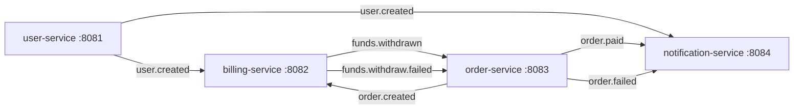

# Shop Stream App

Event-driven микросервисное приложение для обработки заказов с использованием **Event Collaboration** через Apache Kafka. Регистрация → deposit → заказ → асинхронное списание → HAPPY/ANGRY уведомления.

## 📚 Документация

| Раздел | Файл | О чём |
|---|---|---|
| 🏗 Архитектура | [`docs/architecture.md`](docs/architecture.md) | Event Collaboration, диаграммы компонентов и sequence, Kafka-топики, идемпотентность, ограничения (кратко) |
| 🛠 Технологии | [`docs/technologies.md`](docs/technologies.md) | Backend, БД, брокер, инфраструктура, общие библиотеки, версии |
| 📦 Сервисы | [`docs/services.md`](docs/services.md) | 4 микросервиса + 3 общие библиотеки: роли, БД, топики, ключевые классы |
| 🔀 Kafka топики | [`docs/kafka-topics.md`](docs/kafka-topics.md) | 6 топиков, payload-схемы, ключи, идемпотентность consumer'ов, ручная проверка |
| 🚀 Быстрый старт | [`docs/quickstart.md`](docs/quickstart.md) | Docker Compose и Kubernetes, hosts, переменные окружения, типичные проблемы |
| 📡 API | [`docs/api.md`](docs/api.md) | Все HTTP-эндпоинты, модели, JWT, пример полного сценария `curl` |
| 🧪 Тестирование | [`docs/testing.md`](docs/testing.md) | Postman/Newman, 11 запросов / 22 ассерта, отчёты, диагностика падений |
| 📊 Мониторинг | [`docs/monitoring.md`](docs/monitoring.md) | Actuator, Prometheus, JSON-логи, PromQL, алертинг, нагрузка |
| ⚠️ Ограничения | [`docs/limitations.md`](docs/limitations.md) | 15 осознанных упрощений: Outbox, DLQ, saga, HA, tracing, безопасность, тесты |

Дополнительно:

- [`ARCHITECTURE.md`](ARCHITECTURE.md) — детали Event Collaboration и известные ограничения в исходном виде.
- [`docs/theory.md`](docs/theory.md) — сравнение 4 вариантов взаимодействия (только HTTP, HTTP+Kafka, Event Collaboration, гибрид) с sequence-диаграммами и IDL.
- [`docs/api.yaml`](docs/api.yaml) — OpenAPI 3.0.3 спецификация.

## 🚀 TL;DR — запустить за 3 команды

```bash
./build-all.sh dev        # собрать 4 образа shop/*:dev
docker compose up -d      # postgres + kafka + 4 сервиса + nginx-gateway
./run-newman.sh http://localhost:8080   # E2E: 11 запросов, 22 ассерта
```

Приложение на `http://localhost:8080`, ingress-хост `arch.homework` (для k8s — добавить в `/etc/hosts`). Подробнее — [`docs/quickstart.md`](docs/quickstart.md).

## 🏗 Что внутри (одним взглядом)



- **user-service** — регистрация/логин, публикует `user.created`.
- **billing-service** — аккаунты и балансы, единственный, кто «списывает».
- **order-service** — статус-машина `NEW → PAID | FAILED`.
- **notification-service** — HAPPY/ANGRY уведомления, проекция email.

Подробно — [`docs/architecture.md`](docs/architecture.md) и [`docs/services.md`](docs/services.md).

## 📁 Структура репозитория

```
shop/
├── README.md                       ← этот файл (индекс документации)
├── ARCHITECTURE.md                 ← детали Event Collaboration
├── pom.xml                         ← parent multi-module
├── Dockerfile                      ← multi-stage, ARG MODULE
├── docker-compose.yml              ← локальный стек
├── build-all.sh                    ← сборка 4 образов
├── run-newman.sh                   ← E2E прогон
├── release.sh                      ← шаблон push в registry
│
├── docs/
│   ├── architecture.md             ← 🏗 Архитектура
│   ├── technologies.md             ← 🛠 Технологии
│   ├── services.md                 ← 📦 Сервисы
│   ├── kafka-topics.md             ← 🔀 Kafka топики
│   ├── quickstart.md               ← 🚀 Быстрый старт
│   ├── api.md                      ← 📡 API
│   ├── testing.md                  ← 🧪 Тестирование
│   ├── monitoring.md               ← 📊 Мониторинг
│   ├── limitations.md              ← ⚠️ Ограничения
│   ├── theory.md                   ← сравнение 4 вариантов
│   └── api.yaml                    ← OpenAPI 3.0.3
│
├── common/
│   ├── common-events/              ← Topics + record-события
│   ├── common-security/            ← JwtService, SecurityConfig
│   └── common-logging/             ← RequestLoggingFilter, GlobalExceptionHandler
│
├── user-service/                   ← :8081, user_db
├── billing-service/                ← :8082, billing_db
├── order-service/                  ← :8083, order_db
├── notification-service/           ← :8084, notification_db
│
├── k8s/
│   ├── install.sh / uninstall.sh
│   ├── namespace.yaml
│   ├── common-configmap.yaml / common-secrets.yaml
│   ├── postgres.yaml               ← StatefulSet + init-dbs Job
│   ├── kafka.yaml                  ← StatefulSet (KRaft, single-node)
│   ├── ingress.yaml                ← arch.homework → сервисы
│   └── {user,billing,order,notification}-service/
│
├── etc/
│   ├── shop-stream-app.postman_collection.json  ← E2E (11 запросов)
│   └── shop-local.postman_environment.json
│
└── reports/                        ← newman-<timestamp>.json
```

## 📡 API (кратко)

| Метод | Путь | Сервис | Auth |
|---|---|---|---|
| `POST` | `/auth/register` | user | — |
| `POST` | `/auth/login` | user | — |
| `GET` / `PUT` | `/api/profile` | user | Bearer |
| `GET` | `/billing/accounts/me` | billing | Bearer |
| `POST` | `/billing/accounts/me/deposit` | billing | Bearer |
| `POST` | `/orders` | order | Bearer |
| `GET` | `/orders/{id}` | order | Bearer |
| `GET` | `/orders` | order | Bearer |
| `GET` | `/notifications` | notification | Bearer |
| `GET` | `/health`, `/actuator/*` | все | — |

Полные схемы запросов/ответов и пример `curl` — [`docs/api.md`](docs/api.md), OpenAPI — [`docs/api.yaml`](docs/api.yaml).

## 🔀 Kafka топики (кратко)

| Топик | Producer | Consumers |
|---|---|---|
| `user.created` | user | billing, notification |
| `order.created` | order | billing |
| `funds.withdrawn` | billing | order |
| `funds.withdraw.failed` | billing | order |
| `order.paid` | order | notification |
| `order.failed` | order | notification |

Payload-схемы, ключи, идемпотентность — [`docs/kafka-topics.md`](docs/kafka-topics.md).

## 🧪 Тестирование

```bash
./run-newman.sh                        # http://arch.homework
./run-newman.sh http://localhost:8080  # против Compose
```

11 запросов, 22 ассерта, polling через `postman.setNextRequest`. Отчёты — `reports/newman-<ts>.json`. Детали и диагностика — [`docs/testing.md`](docs/testing.md).

## 📊 Мониторинг

`/actuator/prometheus` на каждом сервисе, JSON-логи с MDC (`request_id`, `http_status`, `duration_ms`). PromQL, Grafana, алерты — [`docs/monitoring.md`](docs/monitoring.md).

## ⚠️ Ограничения (кратко)

Нет **Outbox pattern**, **retry/DLQ**, **saga-компенсации**, **distributed tracing**, **централизованных логов**, **бизнес-метрик**. Kafka и Postgres — single-node. Все 15 пунктов с обоснованием и планом устранения — [`docs/limitations.md`](docs/limitations.md).

Что **реализовано**: идемпотентность consumer'ов (`processed_orders`, `user_email_projection`, статус-машина), единый контракт событий (`common-events`), stateless JWT, JSON-логи, Actuator, readiness/liveness, Liquibase, multi-stage Dockerfile, E2E happy + failure path.

## 🛠 Стек

Java 17 · Spring Boot 3.2.5 · Spring Data JPA · Hibernate · Liquibase · Spring Security + JJWT 0.12.5 · Spring Kafka · PostgreSQL 16 · Apache Kafka 4.1.1 (KRaft) · Micrometer + Prometheus · Logstash Logback Encoder · Docker · Kubernetes · nginx-ingress · Maven.

Полная таблица версий — [`docs/technologies.md`](docs/technologies.md).
```