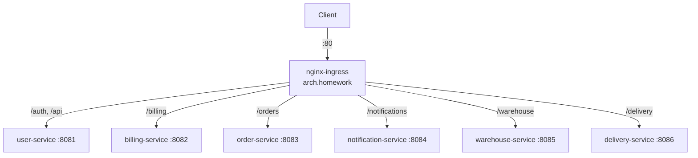
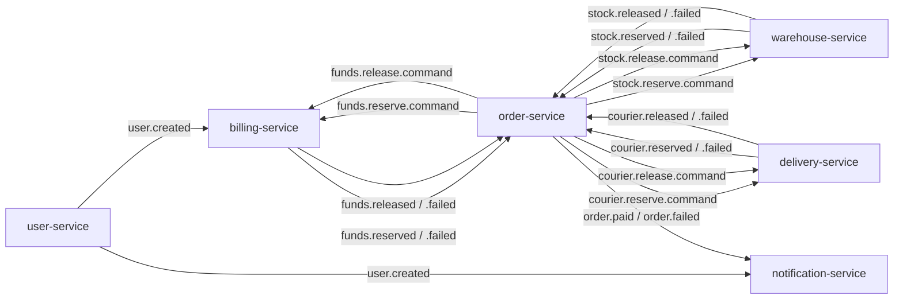
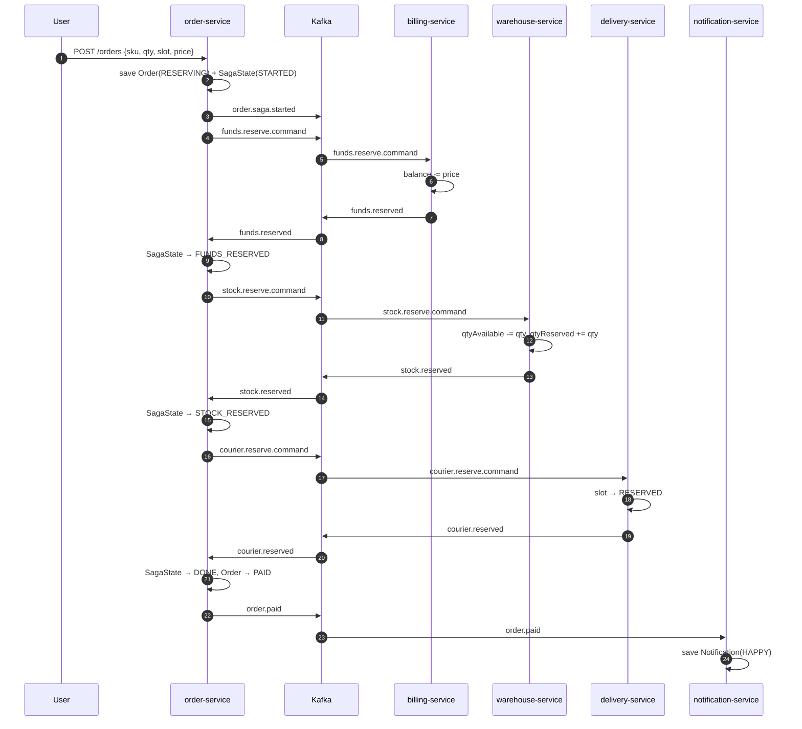
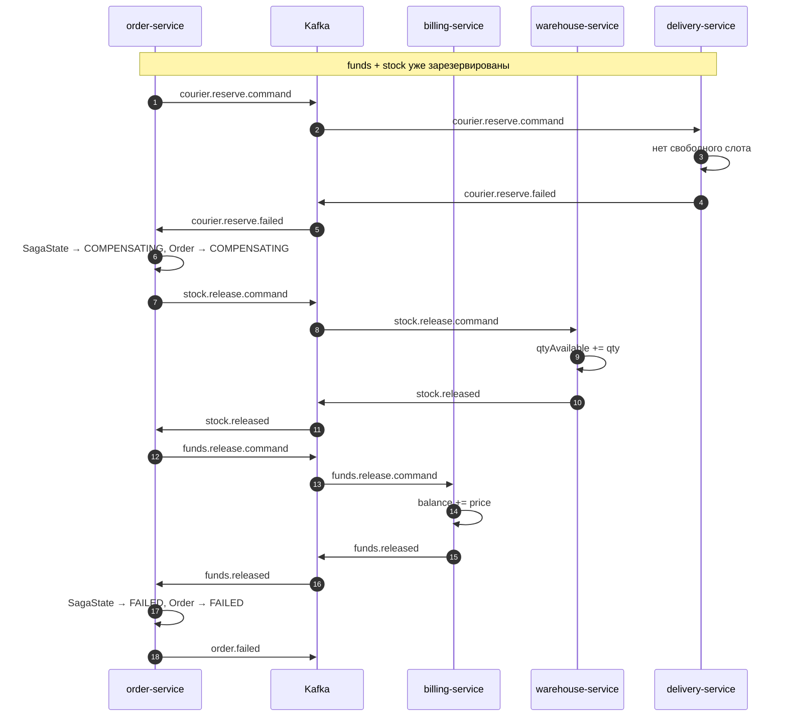

# 🛠 Архитектура и технологии

Документ описывает стек, структуру проекта, схему взаимодействия сервисов и общие библиотеки. Дублирует `docs/technologies.md` — оставлен как единая точка входа для проверяющего.

---

## 1. Стек

### Backend

- **Java 17** — язык программирования (multi-module Maven, `maven.compiler.release=17`)
- **Spring Boot 3.2.5** — базовый фреймворк (`spring-boot-starter-parent`)
- **Spring Web** — REST API (`spring-boot-starter-web`)
- **Spring Data JPA** + **Hibernate** — ORM, `ddl-auto: validate`
- **Spring Security** — stateless JWT-аутентификация
- **JJWT 0.12.5** — генерация и валидация JWT (`jjwt-api`, `jjwt-impl`, `jjwt-jackson`), алгоритм HS256
- **Spring Kafka** — producer/consumer для Event Collaboration и Saga (`spring-kafka`)
- **Spring Boot Actuator** — health-checks, `/actuator/prometheus`
- **Micrometer** — метрики в формате Prometheus (`micrometer-registry-prometheus`), гистограммы `http.server.requests` (p50/p95/p99)
- **Liquibase** — версионирование схемы БД (YAML-чейнджлоги)
- **Bean Validation** (`jakarta.validation`) — валидация DTO (`@NotBlank`, `@Email`, `@Size`, `@DecimalMin`)
- **Logstash Logback Encoder 7.4** — JSON-логи с MDC (`request_id`, `http_method`, `http_path`, `remote_ip`, `http_status`, `duration_ms`)
- **Jackson** — сериализация JSON, `ObjectMapper` для `Idempotency-Key` (сохранение тела ответа)

### Хранение данных

- **PostgreSQL 16** (образ `postgres:16-alpine`)
  - Отдельная БД на сервис: `user_db`, `billing_db`, `order_db`, `notification_db`, `warehouse_db`, `delivery_db`
  - Один инстанс, инициализируется через Job (`postgres-init-dbs`) или `docker/init-db.sql`
  - `pg_isready` как readiness-проба

### Брокер сообщений

- **Apache Kafka 4.1.1** (образ `apache/kafka:4.1.1`)
  - Режим **KRaft** (без ZooKeeper): `KAFKA_PROCESS_ROLES=broker,controller`
  - Single-node, `CLUSTER_ID=4L6G9nxwQreSVeTuSsh_Hg`
  - `auto.create.topics.enable=true` (топики создаются при первом publish)
  - `replication.factor=1` для offsets/transaction state (single-node)
  - Readiness-проба: `kafka-topics.sh --bootstrap-server localhost:9092 --list`

### Инфраструктура

- **Docker** — сборка образов через multi-stage `Dockerfile` с `ARG MODULE`
- **Docker Compose** — локальный запуск всего стека (`docker-compose.yml`), nginx-gateway на `:8080`
- **Kubernetes** — оркестрация (`k8s/`): `StatefulSet` для PostgreSQL и Kafka, `Deployment` для сервисов, `Job` для инициализации БД
- **nginx-ingress** — маршрутизация по хосту `arch.homework` и путям `/auth`, `/api`, `/billing`, `/orders`, `/notifications`, `/warehouse`, `/delivery`
- **Nginx** (alpine) — gateway в Docker Compose (`docker/nginx-gateway.conf`)
- **Helm** — опционально для ingress-nginx / kube-prometheus-stack

### Сборка и запуск

- **Maven 3.9** (`maven:3.9-eclipse-temurin-17` в build-стадии Dockerfile)
- **`build-all.sh`** — собирает 6 образов `shop/<module>:dev`
- **`k8s/install.sh`** — последовательное применение манифестов
- **`run-newman.sh`** — E2E-прогон Postman-коллекций через Newman (`npx newman`), флаг `--saga`

### Инструменты разработки

- **IntelliJ IDEA** (проект с Maven-модулями, Checkstyle-IDEA)
- **Postman / Newman** — E2E-тесты (`etc/shop-stream-app.postman_collection.json`, `etc/shop-saga.postman_collection.json`)
- **Mermaid** — диаграммы в документации (`docs/theory.md`, `docs/kafka-topics.md`, `ARCHITECTURE.md`)

### Сводная таблица версий

| Компонент | Версия |
|---|---|
| Java | 17 |
| Spring Boot | 3.2.5 |
| JJWT | 0.12.5 |
| logstash-logback-encoder | 7.4 |
| PostgreSQL | 16-alpine |
| Apache Kafka | 4.1.1 |
| Maven (build) | 3.9 |

---

## 2. Структура проекта

```
shop/
├── pom.xml                          # parent POM (multi-module)
├── Dockerfile                       # единый для всех сервисов (ARG MODULE)
├── build-all.sh                     # сборка 6 образов
├── run-newman.sh                    # E2E-прогон (stream / saga / both)
├── release.sh                       # шаблон push в registry
├── docker-compose.yml               # локальный стек
├── docker/
│   ├── nginx-gateway.conf
│   └── init-db.sql
├── k8s/
│   ├── install.sh / uninstall.sh
│   ├── namespace.yaml
│   ├── common-configmap.yaml
│   ├── common-secrets.yaml
│   ├── postgres.yaml
│   ├── kafka.yaml
│   ├── ingress.yaml
│   ├── user-service/       {deployment,service}.yaml
│   ├── billing-service/    {deployment,service}.yaml
│   ├── order-service/      {deployment,service}.yaml
│   ├── notification-service/ {deployment,service}.yaml
│   ├── warehouse-service/  {deployment,service}.yaml
│   └── delivery-service/   {deployment,service}.yaml
├── common/
│   ├── common-events/      # Topics, SagaEvents, v1-events
│   ├── common-security/    # JwtService, JwtAuthenticationFilter, SecurityConfig
│   └── common-logging/     # RequestLoggingFilter, GlobalExceptionHandler, logback
├── user-service/           # :8081
├── billing-service/        # :8082
├── order-service/          # :8083 — SagaOrchestrator
├── notification-service/   # :8084
├── warehouse-service/      # :8085
├── delivery-service/       # :8086
├── etc/
│   ├── shop-stream-app.postman_collection.json
│   ├── shop-saga.postman_collection.json
│   └── shop-local.postman_environment.json
├── docs/
│   ├── api.md / api.yaml
│   ├── architecture.md     # этот файл
│   ├── kafka-topics.md
│   ├── limitations.md
│   ├── monitoring.md
│   ├── patterns.md
│   ├── quickstart.md
│   ├── services.md
│   ├── testing.md
│   ├── theory.md
│   └── technologies.md     # дубликат этого файла
└── reports/                # newman-*.json
```

---

## 3. Схема взаимодействия сервисов

### HTTP-слой



### Kafka-слой (Saga, основная)



### Поток создания заказа (Happy path)



### Поток компенсации (провал delivery)



---

## 4. Общие библиотеки (`common/`)

| Модуль | Назначение | Ключевые классы |
|---|---|---|
| `common-events` | Контракты событий и имена топиков | `Topics`, `SagaEvents`, `UserCreatedEvent`, `OrderCreatedEvent`, `OrderPaidEvent`, `OrderFailedEvent`, `FundsWithdrawnEvent`, `FundsWithdrawFailedEvent` |
| `common-security` | JWT, фильтр, SecurityConfig | `JwtService`, `JwtAuthenticationFilter`, `SecurityConfig`, `AuthenticatedUser`, `PasswordEncoder` (BCrypt) |
| `common-logging` | Единое логирование и обработка ошибок | `RequestLoggingFilter`, `GlobalExceptionHandler`, `LifecycleLogger`, `logback-spring.xml` |

### common-events

Все события — Java `record`. Сериализация через `JsonSerializer` без `type`-заголовков. Каждый consumer задаёт `spring.json.value.default.type` явно. Полный список топиков и payload — в [`docs/kafka-topics.md`](kafka-topics.md).

### common-security

- **`JwtService`** — `generateToken(userId, email)`, `extractUserId`, `extractEmail`, `isTokenValid`. HS256, секрет из `security.jwt.secret-key`, TTL из `security.jwt.expiration-ms` (по умолчанию 1 ч).
- **`JwtAuthenticationFilter`** — `OncePerRequestFilter`, парсит `Authorization: Bearer <token>`, кладёт `AuthenticatedUser(id, email)` в `SecurityContext`.
- **`SecurityConfig`** — `permitAll` для `/health`, `/actuator/**`, `/auth/**`; `authenticated` для остального. JSON-ответы `401`/`403`. `BCryptPasswordEncoder` как `PasswordEncoder`.
- **`AuthenticatedUser`** — `record AuthenticatedUser(Long id, String email)`, инжектится в контроллеры через `@AuthenticationPrincipal`.

### common-logging

- **`RequestLoggingFilter`** (`OncePerRequestFilter`, `HIGHEST_PRECEDENCE`) — генерирует `request_id` (UUID), кладёт в MDC `http_method`, `http_path`, `remote_ip`, `http_status`, `duration_ms`, очищает MDC в `finally`.
- **`GlobalExceptionHandler`** (`@RestControllerAdvice`) — JSON-ответы: `400` (валидация, с `details`), `500` (`database_error` / `internal_error`), `403` (`forbidden`).
- **`LifecycleLogger`** — логирует `Application started` / `Application stopping`.
- **`logback-spring.xml`** — `LogstashEncoder` с полем `service` = `spring.application.name`, `@timestamp` вместо `timestamp`.

---

## 5. Ключевые архитектурные решения

### 5.1. Saga Orchestration (не Choreography)

Центральный оркестратор `SagaOrchestrator` в `order-service`. Состояние саги — в таблице `saga_states (order_id PK, step, failure_reason, updated_at)`. Это позволяет:

- переживать рестарт order-service (шаг восстанавливается из БД);
- отлаживать конкретный заказ по `order_id`;
- строить компенсацию строго по тому, что успело зарезервироваться.

Подробнее — в [`docs/patterns.md`](patterns.md).

### 5.2. Идемпотентность HTTP (`Idempotency-Key`)

Клиент передаёт `Idempotency-Key: <uuid>` в `POST /orders`. `OrderService.createIdempotent()` ищет пару `(user_id, idempotency_key)` в `idempotency_keys`. При повторе возвращает сохранённый ответ с `X-Idempotent-Replay: true`. TTL — 24 ч, cleanup-job раз в час.

Подробнее — в [`docs/patterns.md`](patterns.md).

### 5.3. Идемпотентность consumer'ов

Kafka даёт **at-least-once**. Каждый consumer защищён таблицей-маркером:

| Сервис | Таблица-маркер |
|---|---|
| billing | `processed_orders` (v1), `reserved_funds` (saga) |
| warehouse | `reservations` (order_id PK) |
| delivery | `reservations` (order_id PK) |
| order | `SagaState.step` (saga), `status != NEW` (v1) |

### 5.4. v1 и Saga сосуществуют

- `saga.enabled=true` (по умолчанию) — `OrderService.create()` идёт через `createSaga()`.
- `saga.enabled=false` — через `createV1()` (старый Event Collaboration).
- v1- и saga-listener'ы order-service — **разные группы** (`order-service` vs `order-service-saga`). v1-listener пропускает заказы в статусах, отличных от `NEW`, не мешая `SagaOrchestrator`.

### 5.5. Stateless JWT

Нет session store. Горизонтальное масштабирование user-service не требует sticky sessions. Logout не реализован — клиент удаляет токен локально.

---

## 6. Ограничения

См. [`docs/limitations.md`](limitations.md). Кратко:

1. Нет Outbox pattern (событие может потеряться между `save()` и `kafka.send()`).
2. Нет retry / DLQ (consumer при исключении ретраит бесконечно).
3. Нет таймаута в SagaOrchestrator (при потере ответа сага «зависает» в `FUNDS_RESERVED`/`STOCK_RESERVED`).
4. Kafka single-node (`replication.factor=1`).
5. Postgres single-instance (нет реплик, нет backup).
6. Eventual consistency (UI обязан polling'ить `GET /orders/{id}`).
7. Нет distributed tracing (OpenTelemetry / Jaeger).
8. Нет централизованных логов (Loki / ELK).
9. Нет бизнес-метрик (`orders_paid_total`, `funds_withdrawn_total`).
10. Нет оптимистичной блокировки на `accounts` (гонка при `replicas>1`).
11. Нет валидации payload consumer'ов (только `null`-проверки).
12. Секреты в git (`k8s/common-secrets.yaml`), Kafka без TLS/SASL, нет rate-limiting.
13. Нет ролей (только `authenticated`).
14. Нет юнит-тестов (только E2E через Newman).
15. Прочее: `auto.create.topics.enable=true`, нет Schema Registry, нет CI/CD, нет Helm-чарта, `replicas: 1` у всех сервисов.

---

## 7. Ссылки

- [`docs/api.md`](api.md) / [`docs/api.yaml`](api.yaml) — HTTP API
- [`docs/kafka-topics.md`](kafka-topics.md) — топики и payload
- [`docs/services.md`](services.md) — описание 6 сервисов
- [`docs/patterns.md`](patterns.md) — Saga и Idempotency-Key
- [`docs/theory.md`](theory.md) — сравнение вариантов взаимодействия
- [`docs/testing.md`](testing.md) — Postman/Newman
- [`docs/quickstart.md`](quickstart.md) — запуск
- [`docs/monitoring.md`](monitoring.md) — Prometheus/Grafana
- [`docs/limitations.md`](limitations.md) — известные ограничения