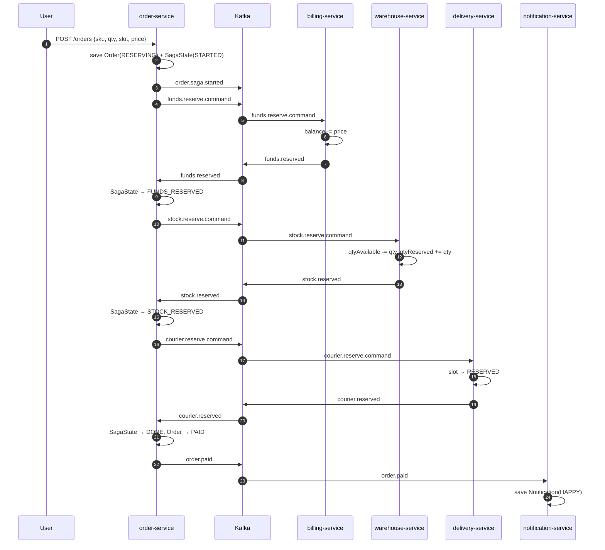
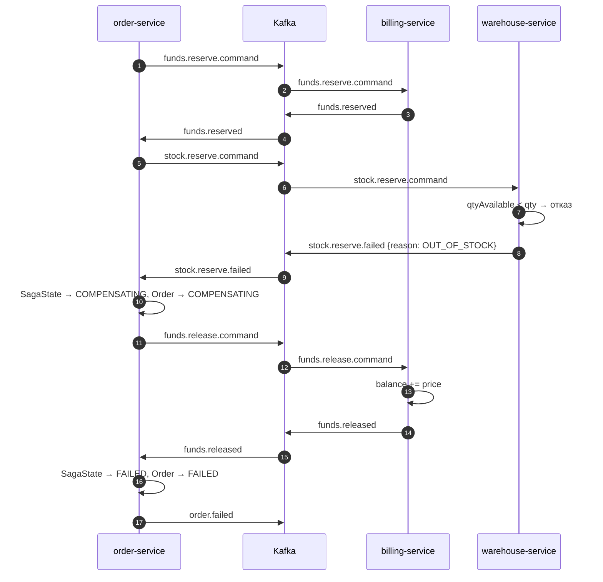
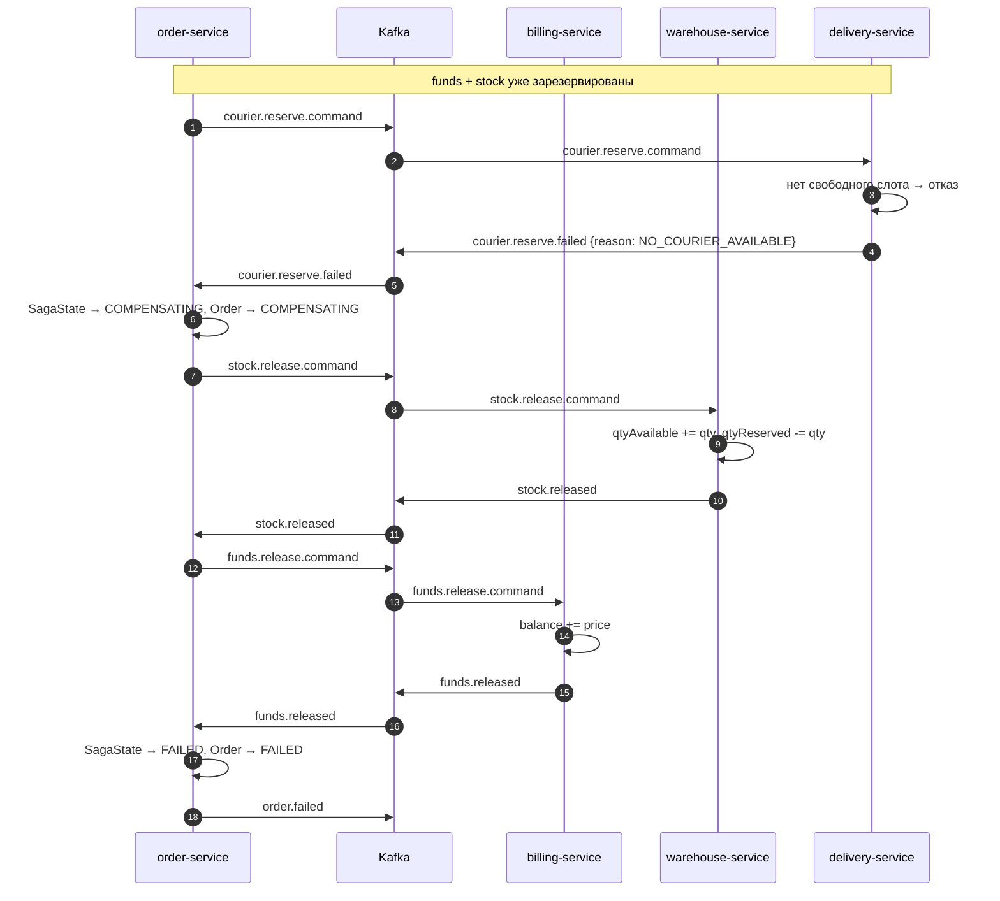

# 🔀 Kafka топики

Все межсервисное взаимодействие идёт через **Kafka**. Имена топиков — константы в `common-events/.../Topics.java`, payload — Java `record` из `SagaEvents.java` и `common-events`. Сериализация: `StringSerializer` для ключа, `JsonSerializer` для значения, без `type`-заголовков (`spring.json.add.type.headers: false`). Каждый consumer явно указывает `spring.json.value.default.type` — это исключает зависимость от заголовков и позволяет читать старые сообщения после эволюции схемы.

В проекте две группы топиков:

- **v1 (Event Collaboration)** — 6 топиков, поток `order.created → funds.withdrawn → order.paid` (без оркестратора).
- **v2 (Saga)** — 23 топика, оркестрация `funds → stock → courier` с компенсациями.

По умолчанию включён режим Saga (`saga.enabled=true`). v1-топики остаются для обратной совместимости и читаются listener'ами, которые пропускают заказы в статусах, отличных от `NEW`.

---

## Сводная таблица v2 (Saga, основная)

| Топик | Producer | Consumer (groupId) | Ключ | Payload |
|---|---|---|---|---|
| `order.saga.started` | order-service | — (audit) | `orderId` | `OrderSagaStartedEvent` |
| `funds.reserve.command` | order-service | billing-service | `orderId` | `ReserveFundsCommand` |
| `funds.reserved` | billing-service | order-service (`order-service-saga`) | `orderId` | `FundsReservedEvent` |
| `funds.reserve.failed` | billing-service | order-service (`order-service-saga`) | `orderId` | `FundsReserveFailedEvent` |
| `funds.release.command` | order-service | billing-service | `orderId` | `ReleaseFundsCommand` |
| `funds.released` | billing-service | order-service (`order-service-saga`) | `orderId` | `FundsReleasedEvent` |
| `funds.release.failed` | billing-service | order-service (`order-service-saga`) | `orderId` | `FundsReleaseFailedEvent` |
| `stock.reserve.command` | order-service | warehouse-service | `orderId` | `ReserveStockCommand` |
| `stock.reserved` | warehouse-service | order-service (`order-service-saga`) | `orderId` | `StockReservedEvent` |
| `stock.reserve.failed` | warehouse-service | order-service (`order-service-saga`) | `orderId` | `StockReserveFailedEvent` |
| `stock.release.command` | order-service | warehouse-service | `orderId` | `ReleaseStockCommand` |
| `stock.released` | warehouse-service | order-service (`order-service-saga`) | `orderId` | `StockReleasedEvent` |
| `stock.release.failed` | warehouse-service | order-service (`order-service-saga`) | `orderId` | `StockReleaseFailedEvent` |
| `courier.reserve.command` | order-service | delivery-service | `orderId` | `ReserveCourierCommand` |
| `courier.reserved` | delivery-service | order-service (`order-service-saga`) | `orderId` | `CourierReservedEvent` |
| `courier.reserve.failed` | delivery-service | order-service (`order-service-saga`) | `orderId` | `CourierReserveFailedEvent` |
| `courier.release.command` | order-service | delivery-service | `orderId` | `ReleaseCourierCommand` |
| `courier.released` | delivery-service | order-service (`order-service-saga`) | `orderId` | `CourierReleasedEvent` |
| `courier.release.failed` | delivery-service | order-service (`order-service-saga`) | `orderId` | `CourierReleaseFailedEvent` |
| `order.paid` | order-service | notification-service | `orderId` | `OrderPaidEvent` |
| `order.failed` | order-service | notification-service | `orderId` | `OrderFailedEvent` |

**Итого:** 21 топик для Saga-команд/событий + `order.saga.started` (audit) + v1-топики = ~23–27 с учётом зарезервированных.

---

## Сводная таблица v1 (Event Collaboration, legacy)

| Топик | Producer | Consumer (groupId) | Ключ | Payload |
|---|---|---|---|---|
| `user.created` | user-service | billing-service, notification-service | `userId` | `UserCreatedEvent` |
| `order.created` | order-service | billing-service | `orderId` | `OrderCreatedEvent` |
| `funds.withdrawn` | billing-service | order-service (`order-service`) | `userId` | `FundsWithdrawnEvent` |
| `funds.withdraw.failed` | billing-service | order-service (`order-service`) | `userId` | `FundsWithdrawFailedEvent` |
| `order.paid` | order-service | notification-service | `orderId` | `OrderPaidEvent` |
| `order.failed` | order-service | notification-service | `orderId` | `OrderFailedEvent` |

> `user.created` — единственный v1-топик, который **актуален и в Saga-режиме**: billing создаёт аккаунт, notification — проекцию email.

---

## Payload — Java records

### v2 (Saga)

```java
// SagaEvents.java
public record OrderSagaStartedEvent(
        Long orderId, Long userId, String sku, Integer qty,
        String deliverySlot, BigDecimal price) {}

// --- funds ---
public record ReserveFundsCommand(Long orderId, Long userId, BigDecimal amount) {}
public record FundsReservedEvent(Long orderId, Long accountId, BigDecimal balance) {}
public record FundsReserveFailedEvent(Long orderId, String reason) {}

public record ReleaseFundsCommand(Long orderId, Long userId, BigDecimal amount) {}
public record FundsReleasedEvent(Long orderId) {}
public record FundsReleaseFailedEvent(Long orderId, String reason) {}

// --- stock ---
public record ReserveStockCommand(Long orderId, String sku, Integer qty) {}
public record StockReservedEvent(Long orderId, String sku, Integer qty) {}
public record StockReserveFailedEvent(Long orderId, String reason) {}

public record ReleaseStockCommand(Long orderId, String sku, Integer qty) {}
public record StockReleasedEvent(Long orderId) {}
public record StockReleaseFailedEvent(Long orderId, String reason) {}

// --- courier ---
public record ReserveCourierCommand(Long orderId, String slot) {}
public record CourierReservedEvent(Long orderId, Long courierId) {}
public record CourierReserveFailedEvent(Long orderId, String reason) {}

public record ReleaseCourierCommand(Long orderId) {}
public record CourierReleasedEvent(Long orderId) {}
public record CourierReleaseFailedEvent(Long orderId, String reason) {}
```

`reason` в `FundsReserveFailedEvent` / `StockReserveFailedEvent` / `CourierReserveFailedEvent` — `INSUFFICIENT_FUNDS`, `NO_ACCOUNT`, `OUT_OF_STOCK`, `SKU_NOT_FOUND`, `NO_COURIER_AVAILABLE`.

### v1 (Event Collaboration, legacy)

```java
public record UserCreatedEvent(Long userId, String email, String name) {}

public record OrderCreatedEvent(Long orderId, Long userId, BigDecimal price) {}
public record OrderPaidEvent(Long orderId, Long userId, BigDecimal price) {}
public record OrderFailedEvent(Long orderId, Long userId, BigDecimal price, String reason) {}

public record FundsWithdrawnEvent(
        Long orderId, Long userId, Long accountId,
        BigDecimal amount, BigDecimal balance) {}
public record FundsWithdrawFailedEvent(
        Long orderId, Long userId, Long accountId,
        BigDecimal amount, String reason) {}
```

---

## Имена топиков — `Topics.java`

```java
public final class Topics {
    // --- v1: Event Collaboration ---
    public static final String USER_CREATED          = "user.created";
    public static final String ORDER_CREATED         = "order.created";
    public static final String FUNDS_WITHDRAWN       = "funds.withdrawn";
    public static final String FUNDS_WITHDRAW_FAILED = "funds.withdraw.failed";
    public static final String ORDER_PAID            = "order.paid";
    public static final String ORDER_FAILED          = "order.failed";

    // --- v2: Saga (orchestration) ---
    public static final String ORDER_SAGA_STARTED       = "order.saga.started";

    public static final String FUNDS_RESERVE_COMMAND    = "funds.reserve.command";
    public static final String FUNDS_RESERVED           = "funds.reserved";
    public static final String FUNDS_RESERVE_FAILED     = "funds.reserve.failed";
    public static final String FUNDS_RELEASE_COMMAND    = "funds.release.command";
    public static final String FUNDS_RELEASED           = "funds.released";
    public static final String FUNDS_RELEASE_FAILED     = "funds.release.failed";

    public static final String STOCK_RESERVE_COMMAND    = "stock.reserve.command";
    public static final String STOCK_RESERVED           = "stock.reserved";
    public static final String STOCK_RESERVE_FAILED     = "stock.reserve.failed";
    public static final String STOCK_RELEASE_COMMAND    = "stock.release.command";
    public static final String STOCK_RELEASED           = "stock.released";
    public static final String STOCK_RELEASE_FAILED     = "stock.release.failed";

    public static final String COURIER_RESERVE_COMMAND  = "courier.reserve.command";
    public static final String COURIER_RESERVED         = "courier.reserved";
    public static final String COURIER_RESERVE_FAILED   = "courier.reserve.failed";
    public static final String COURIER_RELEASE_COMMAND  = "courier.release.command";
    public static final String COURIER_RELEASED         = "courier.released";
    public static final String COURIER_RELEASE_FAILED   = "courier.release.failed";

    private Topics() {}
}
```

Зарезервированные, но не используемые: `account.created`, `funds.deposited`, `notification.sent` — упомянуты в старых версиях, в текущем коде нет.

---

## Поток событий — Happy path



---

## Поток событий — Провал warehouse (компенсация funds)



---

## Поток событий — Провал delivery (компенсация stock + funds)



> Курьер **не освобождается** при провале delivery: по контракту `DeliveryService.reserve` бросает исключение до сохранения `Reservation`, т.е. резерва не было. Если бы `reserve` успел сохранить, а ответ потерялся, `courier.release.command` не шлётся — это ограничение (см. `docs/limitations.md`).

---

## Настройки producer / consumer

Единые для всех сервисов (см. `application.yaml` каждого модуля).

### Producer

```yaml
spring:
  kafka:
    producer:
      key-serializer: org.apache.kafka.common.serialization.StringSerializer
      value-serializer: org.springframework.kafka.support.serializer.JsonSerializer
      properties.spring.json.add.type.headers: false
```

Публикация — асинхронная через `KafkaTemplate.send(topic, key, payload)`, лог в `whenComplete` (offset при успехе, `ex` при ошибке). Ошибка публикации **не откатывает** транзакцию БД (Outbox не реализован — см. `docs/limitations.md` → п. 1).

### Consumer

```yaml
spring:
  kafka:
    consumer:
      group-id: <service-name>
      auto-offset-reset: earliest
      key-deserializer: org.apache.kafka.common.serialization.StringDeserializer
      value-deserializer: org.springframework.kafka.support.serializer.JsonDeserializer
      properties:
        spring.json.trusted.packages: "com.example.shop.common.events"
        spring.json.use.type.headers: false
        spring.json.value.default.type: java.util.Map      # переопределяется в @KafkaListener
```

В каждом `@KafkaListener` тип задаётся явно через `properties`:

```java
@KafkaListener(
    topics = Topics.FUNDS_RESERVED,
    groupId = "order-service-saga",
    properties = {
        "spring.json.value.default.type=com.example.shop.common.events.SagaEvents$FundsReservedEvent",
        "spring.json.use.type.headers=false",
        "spring.json.trusted.packages=com.example.shop.common.events"
    }
)
@Transactional
public void onFundsReserved(FundsReservedEvent e) { ... }
```

`auto-offset-reset: earliest` — новый consumer группы читает топик с начала. Это важно для E2E: user-service публикует `user.created` до того, как notification-service успел стартовать, но проекция email всё равно появится.

---

## Группы consumer'ов

| Сервис | groupId | Топики |
|---|---|---|
| billing-service | `billing-service` | `user.created`, `funds.reserve.command`, `funds.release.command` |
| order-service (v1) | `order-service` | `funds.withdrawn`, `funds.withdraw.failed` |
| order-service (saga) | `order-service-saga` | `funds.reserved`, `funds.reserve.failed`, `funds.released`, `funds.release.failed`, `stock.reserved`, `stock.reserve.failed`, `stock.released`, `stock.release.failed`, `courier.reserved`, `courier.reserve.failed`, `courier.released`, `courier.release.failed` |
| warehouse-service | `warehouse-service` | `stock.reserve.command`, `stock.release.command` |
| delivery-service | `delivery-service` | `courier.reserve.command`, `courier.release.command` |
| notification-service | `notification-service` | `user.created`, `order.paid`, `order.failed` |

**Важно:** v1- и saga-listener'ы order-service — **разные группы**. Это позволяет v1-listener'у пропускать заказы в статусах, отличных от `NEW`, не мешая SagaOrchestrator'у обрабатывать те же топики.

---

## Ключи и партиционирование

- **user-service:** ключ `userId` — все события одного пользователя идут в одну партицию (порядок гарантирован per-user).
- **order-service:** ключ `orderId` — порядок per-order. Для saga-команд и событий это критично: `funds.reserve.command` и `funds.release.command` одного заказа должны обрабатываться в правильном порядке.
- **billing-service:** ключ `userId` для v1 (`funds.withdrawn`, `funds.withdraw.failed`), ключ `orderId` для saga (`funds.reserved`, `funds.released` и т.д.).
- **warehouse-service / delivery-service:** ключ `orderId`.

При `replicas=1` партиционирование не влияет на порядок, но настройка сохранена для будущего масштабирования.

---

## Идемпотентность consumer'ов

Kafka даёт **at-least-once**. Каждый consumer защищён:

| Сервис | Топик | Защита |
|---|---|---|
| billing-service | `user.created` | `accountRepository.existsByUserId(userId)` — пропуск, если аккаунт уже есть |
| billing-service | `funds.reserve.command` | `reservedFundsRepository.existsById(orderId)` — пропуск, если funds уже зарезервированы |
| billing-service | `funds.release.command` | проверка `reservedFundsRepository.findById(orderId)` — если нет, публикует `funds.released` (идемпотентный ответ) |
| billing-service | `order.created` (v1) | `processedOrderRepository.existsById(orderId)` — пропуск |
| warehouse-service | `stock.reserve.command` | `reservationRepository.existsById(orderId)` — пропуск |
| warehouse-service | `stock.release.command` | проверка `reservation.getStatus() == RELEASED` — пропуск |
| delivery-service | `courier.reserve.command` | `reservationRepository.existsById(orderId)` — пропуск |
| delivery-service | `courier.release.command` | проверка `reservation.getStatus() == RELEASED` — пропуск |
| order-service (v1) | `funds.withdrawn`, `funds.withdraw.failed` | `if (status != NEW) skip` — терминальные статусы не меняются |
| order-service (saga) | все saga-события | проверка `SagaState.step` — ожидаемый шаг, иначе пропуск |
| notification-service | `user.created` | `emailRepo.existsById(userId)` — пропуск |
| notification-service | `order.paid` / `order.failed` | не идемпотентен по дизайну — уведомления могут дублироваться при ребалансе; для ДЗ допустимо |

---

## Создание топиков

`KAFKA_AUTO_CREATE_TOPICS_ENABLE=true` в `k8s/kafka.yaml` и `docker-compose.yml` — топики создаются автоматически при первом `send()` с дефолтными параметрами (`replication.factor=1`, `partitions=1`, `retention.ms=604800000`).

Для продакшена топики должны создаваться явно с `replication.factor≥3` и `min.insync.replicas≥2`. См. ограничения в `docs/limitations.md` → п. 4.

---

## Ручная проверка

```bash
# список топиков
kubectl exec -n shop kafka-0 -- \
  /opt/kafka/bin/kafka-topics.sh --bootstrap-server localhost:9092 --list

# чтение с начала (например, saga-команды)
kubectl exec -n shop kafka-0 -- \
  /opt/kafka/bin/kafka-console-consumer.sh \
  --bootstrap-server localhost:9092 \
  --topic funds.reserve.command --from-beginning --max-messages 10

# consumer groups и лаг
kubectl exec -n shop kafka-0 -- \
  /opt/kafka/bin/kafka-consumer-groups.sh \
  --bootstrap-server localhost:9092 --describe --all-groups

# лаг конкретной группы
kubectl exec -n shop kafka-0 -- \
  /opt/kafka/bin/kafka-consumer-groups.sh \
  --bootstrap-server localhost:9092 --describe --group order-service-saga
```

Для Docker Compose замените `kubectl exec -n shop kafka-0 --` на `docker compose exec kafka`.

---

## Проверка конкретного заказа по топикам

```bash
ORDER_ID=12

# все команды/события по заказу (по ключу)
for topic in \
  funds.reserve.command funds.reserved funds.reserve.failed \
  funds.release.command funds.released funds.release.failed \
  stock.reserve.command stock.reserved stock.reserve.failed \
  stock.release.command stock.released stock.release.failed \
  courier.reserve.command courier.reserved courier.reserve.failed \
  courier.release.command courier.released courier.release.failed \
  order.paid order.failed
do
  echo "=== $topic ==="
  kubectl exec -n shop kafka-0 -- \
    /opt/kafka/bin/kafka-console-consumer.sh \
    --bootstrap-server localhost:9092 \
    --topic "$topic" --from-beginning --timeout-ms 2000 2>/dev/null \
    | grep "\"orderId\":$ORDER_ID" || echo "(нет)"
done
```

Или через `saga_states` в БД:

```bash
kubectl exec -n shop postgres-0 -- \
  psql -U app_user -d order_db -c \
  "SELECT order_id, step, failure_reason, updated_at FROM saga_states WHERE order_id = $ORDER_ID;"
```