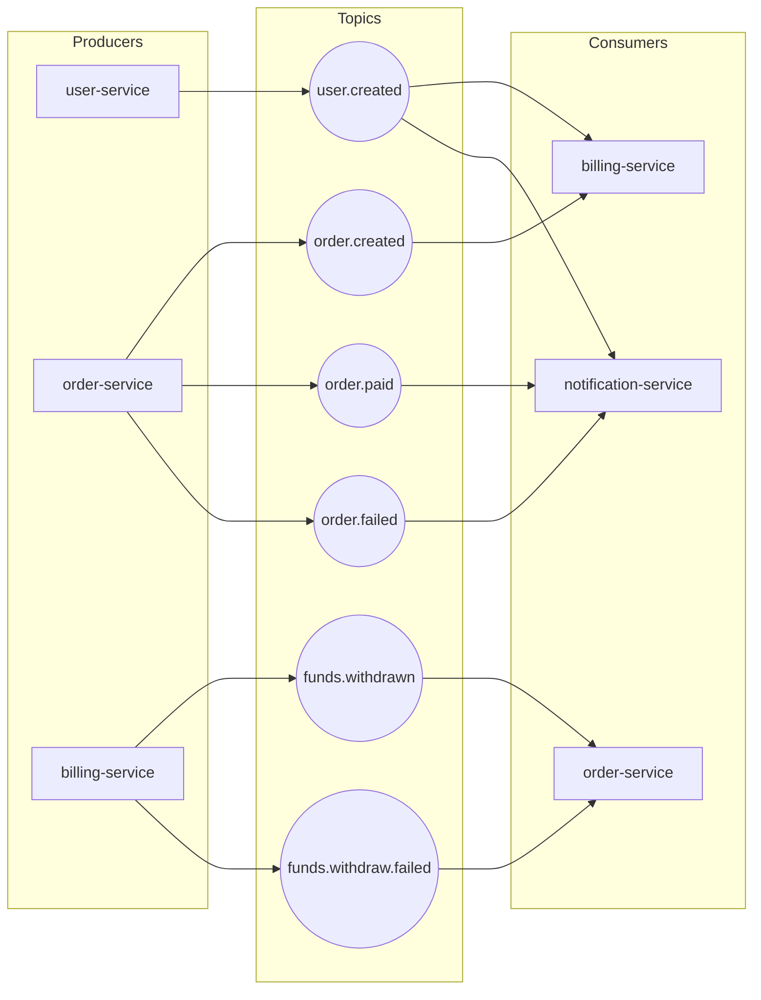

# 🔀 Kafka топики

Все межсервисное взаимодействие идёт через **6 топиков**. Имена — константы в `common-events/.../Topics.java`, payload — Java `record` из того же модуля. Сериализация: `StringSerializer` для ключа, `JsonSerializer` для значения, без `type`-заголовков (`spring.json.add.type.headers: false`). Каждый consumer явно указывает `spring.json.value.default.type` — это исключает зависимость от заголовков и позволяет читать старые сообщения после эволюции схемы.

## Сводная таблица

| Топик | Producer | Consumers (groupId) | Ключ сообщения | Payload |
|---|---|---|---|---|
| `user.created` | user-service | billing-service, notification-service | `userId.toString()` | `UserCreatedEvent` |
| `order.created` | order-service | billing-service | `orderId.toString()` | `OrderCreatedEvent` |
| `funds.withdrawn` | billing-service | order-service | `userId.toString()` | `FundsWithdrawnEvent` |
| `funds.withdraw.failed` | billing-service | order-service | `userId.toString()` | `FundsWithdrawFailedEvent` |
| `order.paid` | order-service | notification-service | `orderId.toString()` | `OrderPaidEvent` |
| `order.failed` | order-service | notification-service | `orderId.toString()` | `OrderFailedEvent` |

## Payload — Java records

```java
public record UserCreatedEvent(Long userId, String email, String name) {}

public record OrderCreatedEvent(Long orderId, Long userId, BigDecimal price) {}

public record FundsWithdrawnEvent(
        Long orderId, Long userId, Long accountId,
        BigDecimal amount, BigDecimal balance) {}

public record FundsWithdrawFailedEvent(
        Long orderId, Long userId, Long accountId,
        BigDecimal amount, String reason) {}

public record OrderPaidEvent(Long orderId, Long userId, BigDecimal price) {}

public record OrderFailedEvent(
        Long orderId, Long userId, BigDecimal price, String reason) {}
```

`reason` в `FundsWithdrawFailedEvent` / `OrderFailedEvent` — `INSUFFICIENT_FUNDS` или `NO_ACCOUNT`.

## Имена топиков

```java
// common/common-events/src/main/java/com/example/shop/common/events/Topics.java
public final class Topics {
    public static final String USER_CREATED          = "user.created";
    public static final String ACCOUNT_CREATED       = "account.created";        // зарезервирован, не используется
    public static final String FUNDS_DEPOSITED       = "funds.deposited";        // зарезервирован, не используется
    public static final String ORDER_CREATED         = "order.created";
    public static final String FUNDS_WITHDRAWN       = "funds.withdrawn";
    public static final String FUNDS_WITHDRAW_FAILED = "funds.withdraw.failed";
    public static final String ORDER_PAID            = "order.paid";
    public static final String ORDER_FAILED          = "order.failed";
    public static final String NOTIFICATION_SENT     = "notification.sent";      // зарезервирован, не используется

    private Topics() {}
}
```

## Поток событий



## Настройки producer / consumer

Единые для всех сервисов (см. `application.yaml` каждого модуля):

### Producer

```yaml
spring:
  kafka:
    producer:
      key-serializer: org.apache.kafka.common.serialization.StringSerializer
      value-serializer: org.springframework.kafka.support.serializer.JsonSerializer
      properties.spring.json.add.type.headers: false
```

Публикация — асинхронная через `KafkaTemplate.send(topic, key, payload)`, лог в `whenComplete` (offset при успехе, `ex` при ошибке). Ошибка публикации **не откатывает** транзакцию БД (Outbox не реализован — см. `ARCHITECTURE.md`).

### Consumer

```yaml
spring:
  kafka:
    consumer:
      group-id: <service-name>
      auto-offset-reset: earliest
      key-deserializer: org.apache.kafka.common.serialization.StringDeserializer
      value-deserializer: org.springframework.kafka.support.serializer.JsonDeserializer
      properties:
        spring.json.trusted.packages: "com.example.shop.common.events"
        spring.json.use.type.headers: false
        spring.json.value.default.type: java.util.Map      # переопределяется в @KafkaListener
```

В каждом `@KafkaListener` тип задаётся явно через `properties`:

```java
@KafkaListener(
    topics = Topics.ORDER_CREATED,
    groupId = "billing-service",
    properties = {
        "spring.json.value.default.type=com.example.shop.common.events.OrderCreatedEvent",
        "spring.json.use.type.headers=false",
        "spring.json.trusted.packages=com.example.shop.common.events"
    }
)
@Transactional
public void onOrderCreated(OrderCreatedEvent e) { ... }
```

`auto-offset-reset: earliest` — новый consumer группы читает топик с начала. Это важно для E2E: user-service публикует `user.created` до того, как notification-service успел стартовать, но проекция email всё равно появится.

## Ключи и партиционирование

- **user-service:** ключ `userId` — все события одного пользователя идут в одну партицию (порядок гарантирован per-user).
- **order-service:** ключ `orderId` — порядок per-order.
- **billing-service:** ключ `userId` — порядок per-user, что важно для серии списаний одного пользователя.

При `replicas=1` партиционирование не влияет на порядок, но настройка сохранена для будущего масштабирования.

## Идемпотентность consumer'ов

Kafka даёт **at-least-once**. Каждый consumer защищён:

| Сервис | Топик | Защита |
|---|---|---|
| billing-service | `user.created` | `accountRepository.existsByUserId(userId)` — пропуск, если аккаунт уже есть |
| billing-service | `order.created` | `processedOrderRepository.existsById(orderId)` — пропуск, если заказ уже обработан |
| order-service | `funds.withdrawn` | `if (status != NEW) skip` — терминальные статусы не меняются |
| order-service | `funds.withdraw.failed` | `if (status != NEW) skip` |
| notification-service | `user.created` | `emailRepo.existsById(userId)` — пропуск |
| notification-service | `order.paid` / `order.failed` | не идемпотентен по дизайну — уведомления могут дублироваться при ребалансе; для ДЗ допустимо |

## Создание топиков

`KAFKA_AUTO_CREATE_TOPICS_ENABLE=true` в `k8s/kafka.yaml` и `docker-compose.yml` — топики создаются автоматически при первом `send()` с дефолтными параметрами (`replication.factor=1`, `partitions=1`, `retention.ms=604800000`).

Для продакшена топики должны создаваться явно с `replication.factor≥3` и `min.insync.replicas≥2`. См. ограничения в `ARCHITECTURE.md`.

## Ручная проверка

```bash
# список топиков
kubectl exec -n shop kafka-0 -- \
  /opt/kafka/bin/kafka-topics.sh --bootstrap-server localhost:9092 --list

# чтение с начала
kubectl exec -n shop kafka-0 -- \
  /opt/kafka/bin/kafka-console-consumer.sh \
  --bootstrap-server localhost:9092 \
  --topic order.created --from-beginning --max-messages 10

# consumer groups и лаг
kubectl exec -n shop kafka-0 -- \
  /opt/kafka/bin/kafka-consumer-groups.sh \
  --bootstrap-server localhost:9092 --describe --all-groups
```

Для Docker Compose замените `kubectl exec -n shop kafka-0 --` на `docker compose exec kafka`.