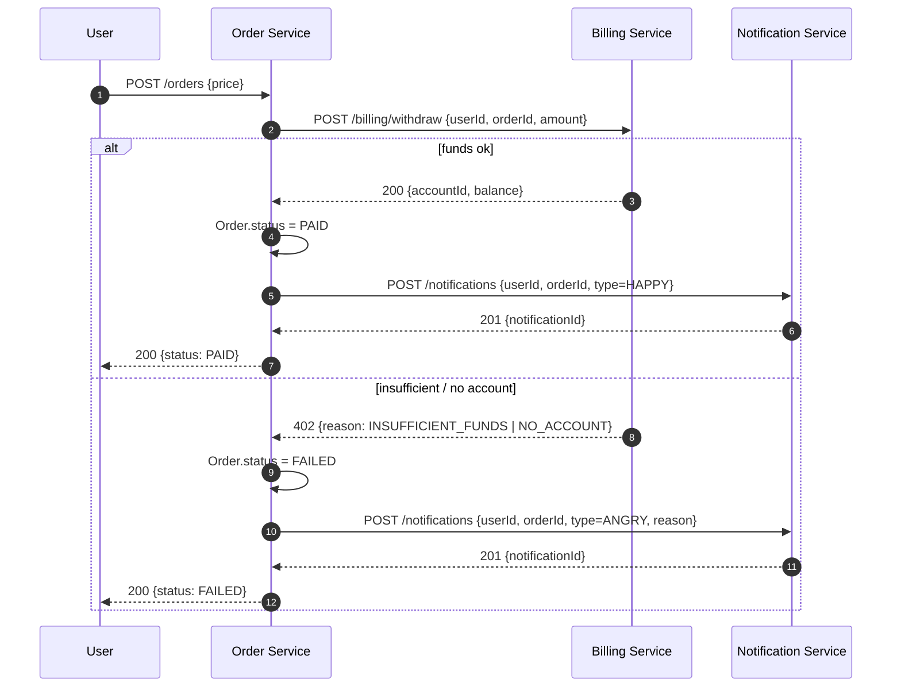
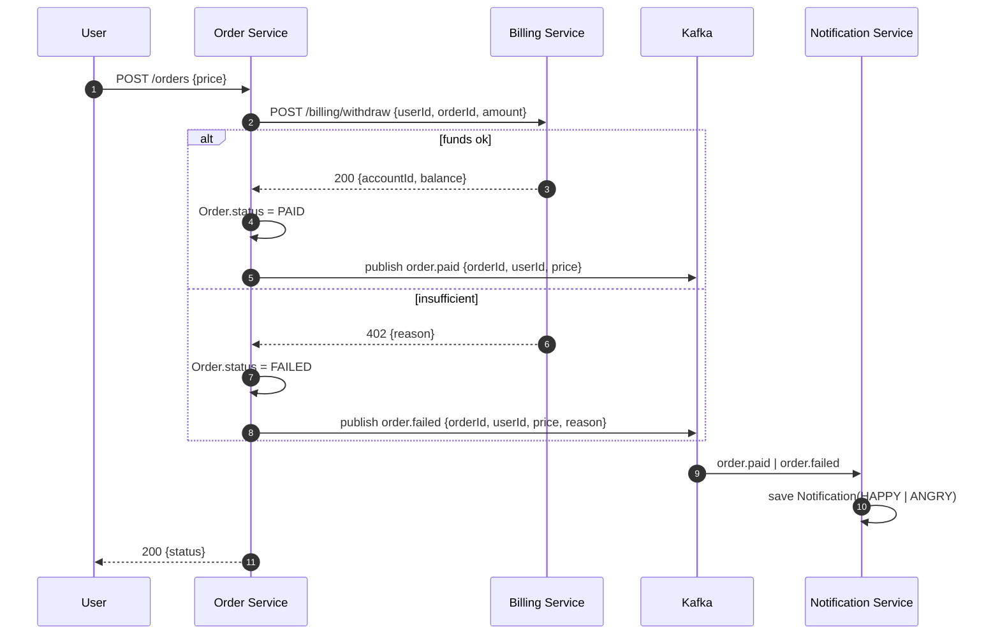
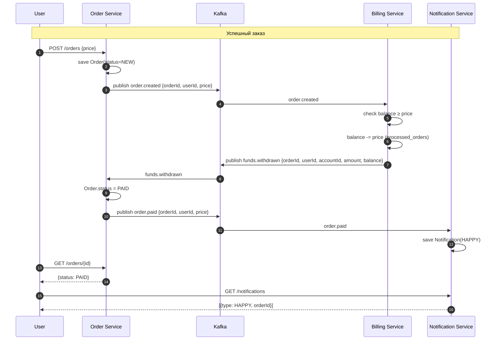
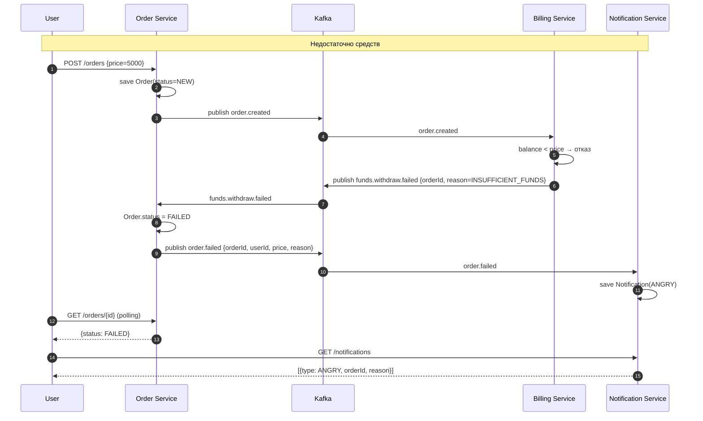
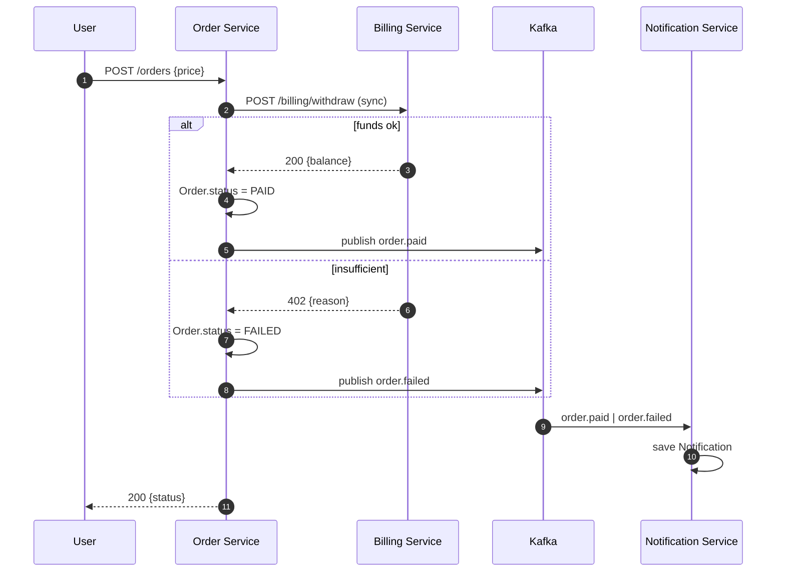
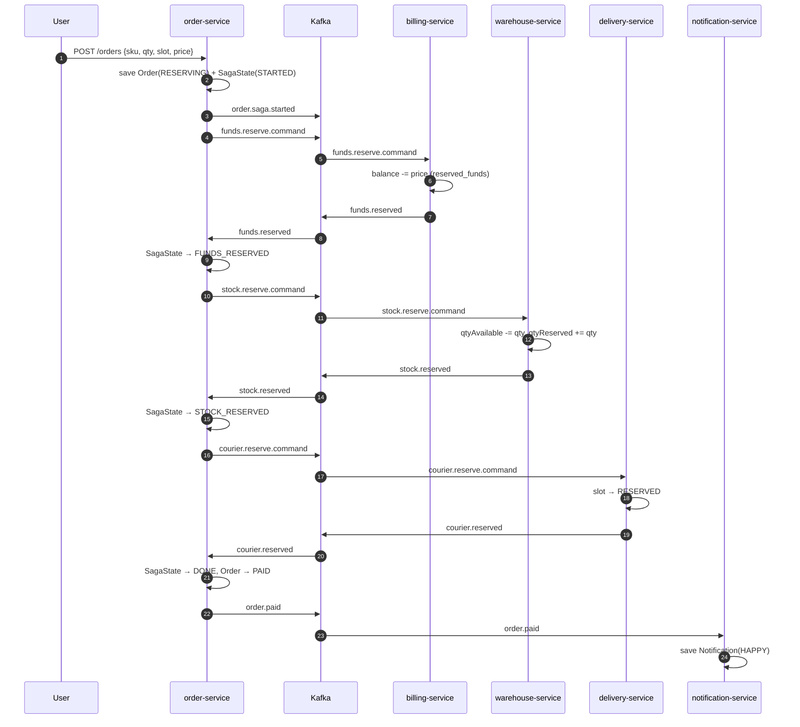

# Теоретическая часть: варианты взаимодействия сервисов

## 1. Сравнение вариантов

| Вариант | Связность | Отказоустойчивость | Сложность | Применимость |
|---|---|---|---|---|
| 1. Только HTTP | сильная | низкая (каскадные отказы) | низкая | MVP, малые системы |
| 2. HTTP + брокер для нотификаций | средняя | средняя | средняя | средние системы |
| 3. Event Collaboration | слабая | высокая | высокая | **выбран для v1** |
| 4. Гибрид (HTTP billing + события notification) | средняя | средняя | средняя | компромисс |
| 5. Saga Orchestration | слабая | высокая | высокая | **выбран для v2 (ДЗ)** |

**Обоснование выбора:** итоговая реализация использует **два режима**, переключаемых флагом `saga.enabled`:

- **v1 (Event Collaboration)** — исторический режим, 6 топиков, цепочка `order.created → funds.withdrawn → order.paid`. Подходит для простых сценариев без компенсаций.
- **v2 (Saga Orchestration)** — основной режим по умолчанию (`saga.enabled=true`), 21+ топик, центральный `SagaOrchestrator` в `order-service`, компенсации в обратном порядке.

Оба режима сосуществуют: v1- и saga-listener'ы order-service — разные группы (`order-service` vs `order-service-saga`), v1-listener пропускает заказы в статусах, отличных от `NEW`.

Плата за Saga — усложнение отладки, необходимость `saga_states`, риск «зависания» при потере события (см. `docs/limitations.md` → п. 3).

---

## 2. Вариант 1. Только HTTP-взаимодействие

Все вызовы синхронные. Order-service напрямую вызывает billing-service
(списание) и notification-service (отправка письма). Если любой из них
недоступен — заказ не создаётся.



### IDL (фрагмент, OpenAPI-style)

```yaml
# Billing Service
POST /billing/withdraw
  body:
    userId:  int64
    orderId: int64
    amount:  decimal
  responses:
    200: { accountId: int64, balance: decimal }
    402: { error: string, reason: enum[INSUFFICIENT_FUNDS, NO_ACCOUNT] }
    404: { error: string }

# Notification Service
POST /notifications
  body:
    userId:  int64
    orderId: int64
    type:    enum[HAPPY, ANGRY]
    subject: string
    body:    string
  responses:
    201: { id: int64 }

# Order Service
POST /orders
  body: { price: decimal }
  responses:
    200: { orderId: int64, status: enum[NEW, PAID, FAILED] }
```

**Плюсы:** простота, транзакционность (всё видно в одном логе), легко тестировать.
**Минусы:** сильная связность; Order-service — единая точка отказа; при падении
Notification не создаётся заказ (что семантически неверно); нет retry без
отдельной логики; нельзя масштабировать независимо.

---

## 3. Вариант 2. HTTP + брокер сообщений для нотификаций

Заказ и списание — синхронно. Отправка уведомлений — через брокер: order-service
публикует `order.paid` / `order.failed`, notification-service подписан.



### IDL

```yaml
# HTTP — как в варианте 1, но без POST /notifications

# Kafka topics
topic: order.paid
  payload: { orderId: int64, userId: int64, price: decimal }

topic: order.failed
  payload: { orderId: int64, userId: int64, price: decimal, reason: string }
```

**Плюсы:** заказ не ждёт отправки email; notification-service можно перезапускать
и масштабировать; billing остаётся синхронным — легко тестировать.
**Минусы:** billing всё ещё SPOF для создания заказа; order-service обязан
вызывать billing синхронно, что ограничивает автономность; нет событий о
факте списания — если billing упадёт после списания, но до ответа, заказ
останется `NEW` при списанных деньгах.

---

## 4. Вариант 3. Event Collaboration (v1, исторический режим)

Единственный канал межсервисного общения — Kafka. Каждый сервис публикует
доменные события о своих изменениях и подписан на события других. Реализовано
в проекте как **v1** (`saga.enabled=false`).





### IDL — HTTP API (v1)

```yaml
POST /auth/register
  body: { name: string, email: string, password: string }
  resp 201: { id: int64, token: string }

GET  /billing/accounts/me
  resp 200: { accountId: int64, userId: int64, balance: decimal }

POST /billing/accounts/me/deposit
  body: { amount: decimal }
  resp 200: { accountId: int64, userId: int64, balance: decimal }

POST /orders
  body: { price: decimal }
  resp 202: { orderId: int64, status: enum[NEW], createdAt: datetime }

GET  /orders/{id}
  resp 200: { orderId: int64, userId: int64, price: decimal,
              status: enum[NEW, PAID, FAILED], createdAt: datetime }

GET  /notifications
  resp 200: [ { id: int64, userId: int64, orderId: int64,
                type: enum[HAPPY, ANGRY], subject: string,
                body: string, createdAt: datetime } ]
```

### IDL — Kafka-события (v1)

```yaml
topic: user.created
  producer: user-service
  consumers: [billing-service, notification-service]
  payload: { userId: int64, email: string, name: string }

topic: order.created
  producer: order-service
  consumers: [billing-service]
  payload: { orderId: int64, userId: int64, price: decimal }

topic: funds.withdrawn
  producer: billing-service
  consumers: [order-service]
  payload: { orderId: int64, userId: int64, accountId: int64,
             amount: decimal, balance: decimal }

topic: funds.withdraw.failed
  producer: billing-service
  consumers: [order-service]
  payload: { orderId: int64, userId: int64, accountId: int64?,
             amount: decimal, reason: string }

topic: order.paid
  producer: order-service
  consumers: [notification-service]
  payload: { orderId: int64, userId: int64, price: decimal }

topic: order.failed
  producer: order-service
  consumers: [notification-service]
  payload: { orderId: int64, userId: int64, price: decimal, reason: string }
```

**Плюсы:** слабая связность; сервисы автономны; отказ одного сервиса не
блокирует остальные; легко масштабировать; явная идемпотентность.
**Минусы:** eventual consistency (нужен polling или WebSocket для UI);
сложнее отладка (нужен distributed tracing); требуется проектировать
идемпотентность и DLQ; **нет компенсаций** — если после `funds.withdrawn`
что-то упало, деньги уже списаны, откатывать нечем.

---

## 5. Вариант 4. Гибрид (HTTP для billing + события для notification)

Списание — синхронно (проще гарантировать консистентность баланса),
уведомления — через брокер.



### IDL

Комбинация IDL из варианта 1 (`/billing/withdraw`) и варианта 2
(Kafka-топики `order.paid` / `order.failed`).

**Плюсы:** баланс консистентен сразу после ответа; отправка email не блокирует
заказ; проще, чем полный Event Collaboration.
**Минусы:** order-service обязан знать про billing (сильная связность по
одному плечу); если billing упадёт после списания, но до ответа — заказ
останется `NEW` при списанных деньгах (та же проблема, что в варианте 2);
billing остаётся SPOF.

---

## 6. Вариант 5. Saga Orchestration (v2, основной режим ДЗ)

Центральный оркестратор в `order-service` (`SagaOrchestrator`) управляет
последовательностью шагов: `funds → stock → courier`. Каждый шаг — команда
в Kafka, ответ — событие. При провале любого шага — компенсация в обратном
порядке. Состояние саги — в таблице `saga_states`.

### 6.1. Почему Orchestration, а не Choreography

**Choreography** — каждый сервис сам решает, что делать, на основе событий.
Нет центральной точки, но и нет явного владельца состояния саги. При трёх
участниках и жёстком порядке шагов это приводит к:

- размазыванию логики компенсации по всем сервисам;
- сложности отладки (непонятно, на каком шаге заказ);
- невозможности быстро ответить «что с заказом X».

**Orchestration** — один сервис знает весь план и состояние. Компенсация —
в одном месте (`SagaOrchestrator.compensate`). Состояние — в `saga_states`,
что позволяет переживать рестарт и отлаживать по `order_id`.

**Плата:** оркестратор — потенциальная SPOF (лечится репликацией +
stateless-логикой, читающей `saga_states`); оркестратор знает про всех
участников (связность выше, чем в чистом Event Collaboration).

### 6.2. Поток событий (Happy path)



### 6.3. Компенсации

| Где провалились | `doneStep` | Что откатываем |
|---|---|---|
| billing (`funds.reserve.failed`) | `STARTED` | ничего — деньги не списаны |
| warehouse (`stock.reserve.failed`) | `FUNDS_RESERVED` | `funds.release.command` |
| delivery (`courier.reserve.failed`) | `STOCK_RESERVED` | `stock.release.command` → после `stock.released` цепочкой `funds.release.command` |

Курьер **не освобождается** при провале delivery — по контракту
`DeliveryService.reserve` бросает исключение до сохранения `Reservation`.
Ограничение (если `reserve` упал после `save`) — см. `docs/limitations.md` → п. 15.

### 6.4. IDL — HTTP API (v2)

```yaml
POST /orders
  headers: { Idempotency-Key: string? }
  body: { sku: string, qty: int, deliverySlot: string, price: decimal }
  resp 202: { orderId: int64, userId: int64, price: decimal,
              sku: string, qty: int, deliverySlot: string,
              status: enum[RESERVING], createdAt: datetime }
  resp 400: { error: validation }

GET /orders/{id}
  resp 200: { orderId: int64, ..., status: enum[RESERVING, PAID, COMPENSATING, FAILED, COMPENSATION_FAILED] }
  resp 403: { error: forbidden }
```

### 6.5. IDL — Kafka-события (v2)

```yaml
topic: funds.reserve.command
  producer: order-service
  consumers: [billing-service]
  payload: { orderId, userId, amount }

topic: funds.reserved
  producer: billing-service
  consumers: [order-service (order-service-saga)]
  payload: { orderId, accountId, balance }

topic: funds.reserve.failed
  producer: billing-service
  consumers: [order-service (order-service-saga)]
  payload: { orderId, reason }

topic: stock.reserve.command
  producer: order-service
  consumers: [warehouse-service]
  payload: { orderId, sku, qty }

topic: stock.reserved
  producer: warehouse-service
  consumers: [order-service (order-service-saga)]
  payload: { orderId, sku, qty }

topic: stock.reserve.failed
  producer: warehouse-service
  consumers: [order-service (order-service-saga)]
  payload: { orderId, reason }

topic: courier.reserve.command
  producer: order-service
  consumers: [delivery-service]
  payload: { orderId, slot }

topic: courier.reserved
  producer: delivery-service
  consumers: [order-service (order-service-saga)]
  payload: { orderId, courierId }

topic: courier.reserve.failed
  producer: delivery-service
  consumers: [order-service (order-service-saga)]
  payload: { orderId, reason }

# компенсации
topic: funds.release.command
  producer: order-service
  consumers: [billing-service]
  payload: { orderId, userId, amount }

topic: funds.released
  producer: billing-service
  consumers: [order-service (order-service-saga)]
  payload: { orderId }

topic: stock.release.command
  producer: order-service
  consumers: [warehouse-service]
  payload: { orderId, sku, qty }

topic: stock.released
  producer: warehouse-service
  consumers: [order-service (order-service-saga)]
  payload: { orderId }

# финал
topic: order.paid
  producer: order-service
  consumers: [notification-service]
  payload: { orderId, userId, price }

topic: order.failed
  producer: order-service
  consumers: [notification-service]
  payload: { orderId, userId, price, reason }
```

**Плюсы:** слабая связность (каждый сервис знает только свои команды);
явная компенсация в одном месте; состояние саги переживает рестарт;
идемпотентность на уровне шагов (`SagaState.step`); легко добавить
новый шаг (новая команда/событие + ветка в `SagaOrchestrator`).
**Минусы:** eventual consistency; сложнее отладка (нужен tracing по
`orderId`); риск «зависания» без таймаута (см. `docs/limitations.md` → п. 3);
оркестратор знает про всех участников.

---

## 7. Итоговая таблица выбора

| Критерий | В1 HTTP | В2 HTTP+Kafka | В3 Event Collab | В4 Гибрид | В5 Saga |
|---|---|---|---|---|---|
| Слабая связность | ✗ | ~ | ✓ | ~ | ~ |
| Отказоустойчивость | ✗ | ~ | ✓ | ~ | ✓ |
| Компенсации | ✗ | ✗ | ✗ | ✗ | **✓** |
| Простота отладки | ✓ | ~ | ✗ | ~ | ~ |
| Консистентность баланса | ✓ | ~ | ~ | ✓ | ~ |
| Масштабируемость | ✗ | ~ | ✓ | ~ | ✓ |
| Соответствие ДЗ №1 (распределённые транзакции) | ✗ | ✗ | ✗ | ✗ | **✓** |
| Соответствие ДЗ №2 (идемпотентность) | ~ | ~ | ~ | ~ | **✓** (Idempotency-Key) |

**Выбрано:**

- **v1 (Event Collaboration)** — как исторический режим, демонстрирующий
  слабую связность и идемпотентность consumer'ов.
- **v2 (Saga Orchestration)** — как основной режим, отвечающий цели
  ДЗ №1 «реализовать механизм распределённой транзакции» с компенсациями.
  Идемпотентность HTTP (`Idempotency-Key`) закрывает ДЗ №2.

Реализация — в основном коде проекта: `SagaOrchestrator` (order-service),
`SagaFundsListener` (billing), `StockEventsListener` (warehouse),
`CourierEventsListener` (delivery), `common-events/SagaEvents.java`,
`docs/patterns.md`.