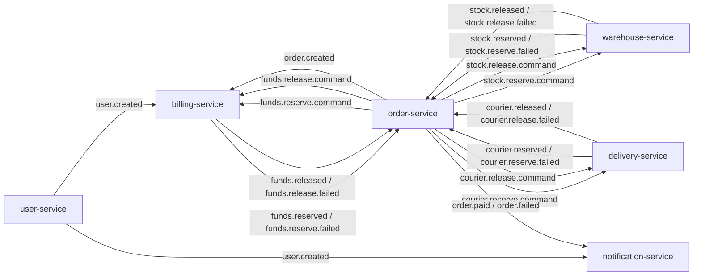

# 📦 Сервисы

Всего в проекте **10 Maven-модулей**: 6 исполняемых микросервисов и 4 общие библиотеки (`common/*`). Каждый микросервис — отдельное Spring Boot приложение со своей БД и своим `pom.xml`.

## Исполняемые сервисы

| Модуль | Порт | Назначение | БД | Kafka producer | Kafka consumer |
|---|---|---|---|---|---|
| `user-service` | 8081 | Регистрация, логин, профиль | `user_db` | `user.created` | — |
| `billing-service` | 8082 | Аккаунты, депозит, резерв/списание funds | `billing_db` | `funds.*` (v1 + saga) | `user.created`, `funds.reserve.command`, `funds.release.command` |
| `order-service` | 8083 | Создание и статус заказов, **SagaOrchestrator** | `order_db` | `order.created`, `order.paid`, `order.failed`, `*reserve.command`, `*release.command` | `funds.*`, `stock.*`, `courier.*` (v1 + saga) |
| `notification-service` | 8084 | HAPPY/ANGRY уведомления, проекция email | `notification_db` | — | `user.created`, `order.paid`, `order.failed` |
| `warehouse-service` | 8085 | Резерв/освобождение товара | `warehouse_db` | `stock.reserved`, `stock.reserve.failed`, `stock.released`, `stock.release.failed` | `stock.reserve.command`, `stock.release.command` |
| `delivery-service` | 8086 | Резерв/освобождение курьера на слот | `delivery_db` | `courier.reserved`, `courier.reserve.failed`, `courier.released`, `courier.release.failed` | `courier.reserve.command`, `courier.release.command` |

### user-service

- **Роль:** точка входа пользователя, источник `user.created`.
- **HTTP API:** `POST /auth/register`, `POST /auth/login`, `GET /api/profile`, `PUT /api/profile`, `GET /health`.
- **Схема БД:** `users (id, name, email UNIQUE, password BCrypt)` — миграция `001-create-users.yaml`.
- **Публикует:** `UserCreatedEvent(userId, email, name)` при регистрации (`UserEventPublisher.publishUserCreated`).
- **Не подписан** ни на какие топики.
- **Ключевые классы:** `AuthController`, `ProfileController`, `UserEventPublisher`, `UserRepository`, `User`.

### billing-service

- **Роль:** держатель балансов, единственный, кто «резервирует» и «списывает» деньги.
- **HTTP API:** `GET /billing/accounts/me`, `POST /billing/accounts/me/deposit`, `GET /health`.
- **Схема БД:**
  - `accounts (id, user_id UNIQUE, balance NUMERIC(19,2))`
  - `processed_orders (order_id PK, processed_at)` — защита от повторного списания в v1.
  - `reserved_funds (order_id PK, user_id, amount, created_at)` — защита от повторного резерва в saga.
- **Подписан:**
  - `user.created` → создаёт аккаунт с балансом `0.00` (идемпотентно через `existsByUserId`).
  - `order.created` (v1) → проверяет баланс; при успехе списывает и публикует `funds.withdrawn`, при нехватке — `funds.withdraw.failed`.
  - `funds.reserve.command` (saga) → резервирует funds, публикует `funds.reserved` / `funds.reserve.failed`.
  - `funds.release.command` (saga) → возвращает funds, публикует `funds.released` / `funds.release.failed`.
- **Публикует:** `FundsWithdrawnEvent`, `FundsWithdrawFailedEvent` (v1), `FundsReservedEvent`, `FundsReserveFailedEvent`, `FundsReleasedEvent`, `FundsReleaseFailedEvent` (saga).
- **Ключевые классы:** `UserEventsListener`, `OrderEventsListener` (v1), `SagaFundsListener` (saga), `BillingEventPublisher`, `AccountService`, `Account`, `ProcessedOrder`, `ReservedFunds`.

### order-service

- **Роль:** оркестратор заказа, реализует статус-машину Saga и v1-fallback.
- **HTTP API:** `POST /orders` (→ `202 Accepted`), `GET /orders/{id}`, `GET /orders`, `GET /health`.
- **Схема БД:**
  - `orders (id, user_id, price NUMERIC(19,2), sku, qty, delivery_slot, status VARCHAR(32), created_at)` + индекс `idx_orders_user_id`.
  - `saga_states (order_id PK, step, failure_reason, updated_at)` — состояние оркестратора.
  - `idempotency_keys (id, user_id, idempotency_key, order_id, response_body, http_status, created_at)` + `UNIQUE(user_id, idempotency_key)` — идемпотентность `POST /orders`.
- **Публикует:**
  - **v1:** `order.created`, `order.paid`, `order.failed`.
  - **saga:** `order.saga.started`, `funds.reserve.command`, `stock.reserve.command`, `courier.reserve.command`, `funds.release.command`, `stock.release.command`, `courier.release.command`, `order.paid`, `order.failed`.
- **Подписан:**
  - **v1 (groupId `order-service`):** `funds.withdrawn`, `funds.withdraw.failed` — обновляет статус `NEW → PAID|FAILED`.
  - **saga (groupId `order-service-saga`):** `funds.reserved`, `funds.reserve.failed`, `stock.reserved`, `stock.reserve.failed`, `courier.reserved`, `courier.reserve.failed`, `funds.released`, `funds.release.failed`, `stock.released`, `stock.release.failed`, `courier.released`, `courier.release.failed` — двигает `SagaState` и запускает компенсации.
- **Идемпотентность:**
  - v1-listener: `if (status != NEW) skip`.
  - saga-listener: проверка `SagaState.step` — ожидаемый шаг, иначе пропуск.
  - HTTP: `Idempotency-Key` + таблица `idempotency_keys` (см. `docs/patterns.md`).
- **Ключевые классы:** `OrderController`, `OrderService`, `SagaOrchestrator`, `OrderEventPublisher`, `BillingEventsListener` (v1), `Order`, `SagaState`, `IdempotencyKey`, `IdempotencyKeyCleanupJob`.

### notification-service

- **Роль:** материализует уведомления для UI и хранит проекцию email.
- **HTTP API:** `GET /notifications`, `GET /health`.
- **Схема БД:**
  - `notifications (id, user_id, order_id, type HAPPY|ANGRY, subject, body, created_at)` + индекс `idx_notifications_user_id`.
  - `user_email_projection (user_id PK, email)` — проекция email из `user.created`.
- **Подписан:**
  - `user.created` → сохраняет email в `user_email_projection`.
  - `order.paid` → `NotificationService.saveHappy(...)` — уведомление `HAPPY`.
  - `order.failed` → `NotificationService.saveAngry(...)` — уведомление `ANGRY` с причиной.
- **Не публикует** события (leaf-consumer).
- **Ключевые классы:** `NotificationController`, `NotificationService`, `UserEventsListener`, `OrderEventsListener`, `Notification`, `UserEmailProjection`.

### warehouse-service

- **Роль:** резерв и освобождение товара на складе.
- **HTTP API:** `GET /warehouse/stock`, `GET /health`.
- **Схема БД:**
  - `stock (sku PK, qty_available, qty_reserved)` — миграция `001-create-stock.yaml` + seed `003-seed-stock.yaml` (10 SKU по 100 шт).
  - `reservations (order_id PK, sku, qty, status RESERVED|RELEASED, created_at)` — защита от повторного резерва.
- **Подписан:**
  - `stock.reserve.command` → `WarehouseService.reserve(orderId, sku, qty)`:
    - если `reservationRepository.existsById(orderId)` — идемпотентный пропуск;
    - если `stock.qtyAvailable < qty` — `stock.reserve.failed {reason: OUT_OF_STOCK}`;
    - иначе `qtyAvailable -= qty`, `qtyReserved += qty`, сохраняет `Reservation`, публикует `stock.reserved`.
  - `stock.release.command` → `WarehouseService.release(orderId)`:
    - если `reservation == null || status == RELEASED` — идемпотентный пропуск;
    - иначе `qtyAvailable += qty`, `qtyReserved -= qty`, `status = RELEASED`, публикует `stock.released`.
- **Публикует:** `StockReservedEvent`, `StockReserveFailedEvent`, `StockReleasedEvent`, `StockReleaseFailedEvent`.
- **Ключевые классы:** `StockEventsListener`, `WarehouseService`, `StockController`, `Stock`, `Reservation`.

### delivery-service

- **Роль:** резерв и освобождение курьера на конкретный слот времени.
- **HTTP API:** `GET /delivery/slots`, `GET /health`.
- **Схема БД:**
  - `courier_slots (id, courier_id, slot, status FREE|RESERVED)` — миграция `001-create-courier-slots.yaml` + seed `003-seed-slots.yaml` (30 дней × 4 слота × 3 курьера).
  - `reservations (order_id PK, courier_id, slot, status RESERVED|RELEASED, created_at)` — защита от повторного резерва.
- **Подписан:**
  - `courier.reserve.command` → `DeliveryService.reserve(orderId, slot)`:
    - если `reservationRepository.existsById(orderId)` — идемпотентный пропуск;
    - если нет `FREE`-слота — `IllegalStateException("NO_COURIER_AVAILABLE")` → `courier.reserve.failed`;
    - иначе `slot.status = RESERVED`, сохраняет `Reservation`, публикует `courier.reserved`.
  - `courier.release.command` → `DeliveryService.release(orderId)`:
    - если `reservation == null || status == RELEASED` — идемпотентный пропуск;
    - иначе `slot.status = FREE`, `reservation.status = RELEASED`, публикует `courier.released`.
- **Публикует:** `CourierReservedEvent`, `CourierReserveFailedEvent`, `CourierReleasedEvent`, `CourierReleaseFailedEvent`.
- **Ключевые классы:** `CourierEventsListener`, `DeliveryService`, `SlotsController`, `CourierSlot`, `Reservation`.

## Общие библиотеки

### common-events

Контракты событий — обычные Java `record`. Используются всеми сервисами (producer и consumer).

```java
// Topics.java — v1
public static final String USER_CREATED          = "user.created";
public static final String ORDER_CREATED         = "order.created";
public static final String FUNDS_WITHDRAWN       = "funds.withdrawn";
public static final String FUNDS_WITHDRAW_FAILED = "funds.withdraw.failed";
public static final String ORDER_PAID            = "order.paid";
public static final String ORDER_FAILED          = "order.failed";

// Topics.java — saga
public static final String ORDER_SAGA_STARTED       = "order.saga.started";
public static final String FUNDS_RESERVE_COMMAND    = "funds.reserve.command";
public static final String FUNDS_RESERVED           = "funds.reserved";
public static final String FUNDS_RESERVE_FAILED     = "funds.reserve.failed";
public static final String FUNDS_RELEASE_COMMAND    = "funds.release.command";
public static final String FUNDS_RELEASED           = "funds.released";
public static final String FUNDS_RELEASE_FAILED     = "funds.release.failed";
public static final String STOCK_RESERVE_COMMAND    = "stock.reserve.command";
public static final String STOCK_RESERVED           = "stock.reserved";
public static final String STOCK_RESERVE_FAILED     = "stock.reserve.failed";
public static final String STOCK_RELEASE_COMMAND    = "stock.release.command";
public static final String STOCK_RELEASED           = "stock.released";
public static final String STOCK_RELEASE_FAILED     = "stock.release.failed";
public static final String COURIER_RESERVE_COMMAND  = "courier.reserve.command";
public static final String COURIER_RESERVED         = "courier.reserved";
public static final String COURIER_RESERVE_FAILED   = "courier.reserve.failed";
public static final String COURIER_RELEASE_COMMAND  = "courier.release.command";
public static final String COURIER_RELEASED         = "courier.released";
public static final String COURIER_RELEASE_FAILED   = "courier.release.failed";

// Records — v1
public record UserCreatedEvent(Long userId, String email, String name) {}
public record OrderCreatedEvent(Long orderId, Long userId, BigDecimal price) {}
public record FundsWithdrawnEvent(Long orderId, Long userId, Long accountId,
                                  BigDecimal amount, BigDecimal balance) {}
public record FundsWithdrawFailedEvent(Long orderId, Long userId, Long accountId,
                                       BigDecimal amount, String reason) {}
public record OrderPaidEvent(Long orderId, Long userId, BigDecimal price) {}
public record OrderFailedEvent(Long orderId, Long userId, BigDecimal price, String reason) {}

// Records — saga (SagaEvents.java)
public record OrderSagaStartedEvent(Long orderId, Long userId, String sku,
                                    Integer qty, String deliverySlot, BigDecimal price) {}
public record ReserveFundsCommand(Long orderId, Long userId, BigDecimal amount) {}
public record FundsReservedEvent(Long orderId, Long accountId, BigDecimal balance) {}
public record FundsReserveFailedEvent(Long orderId, String reason) {}
public record ReleaseFundsCommand(Long orderId, Long userId, BigDecimal amount) {}
public record FundsReleasedEvent(Long orderId) {}
public record FundsReleaseFailedEvent(Long orderId, String reason) {}
public record ReserveStockCommand(Long orderId, String sku, Integer qty) {}
public record StockReservedEvent(Long orderId, String sku, Integer qty) {}
public record StockReserveFailedEvent(Long orderId, String reason) {}
public record ReleaseStockCommand(Long orderId, String sku, Integer qty) {}
public record StockReleasedEvent(Long orderId) {}
public record StockReleaseFailedEvent(Long orderId, String reason) {}
public record ReserveCourierCommand(Long orderId, String slot) {}
public record CourierReservedEvent(Long orderId, Long courierId) {}
public record CourierReserveFailedEvent(Long orderId, String reason) {}
public record ReleaseCourierCommand(Long orderId) {}
public record CourierReleasedEvent(Long orderId) {}
public record CourierReleaseFailedEvent(Long orderId, String reason) {}
```

### common-security

Stateless JWT-аутентификация для всех сервисов.

- **`JwtService`** — `generateToken(userId, email)`, `extractUserId`, `extractEmail`, `isTokenValid`. HS256, секрет из `security.jwt.secret-key`, TTL из `security.jwt.expiration-ms` (по умолчанию 1 ч).
- **`JwtAuthenticationFilter`** — `OncePerRequestFilter`, парсит `Authorization: Bearer <token>`, кладёт `AuthenticatedUser(id, email)` в `SecurityContext`.
- **`SecurityConfig`** — `permitAll` для `/health`, `/actuator/**`, `/auth/**`; `authenticated` для остального. JSON-ответы `401`/`403`. `BCryptPasswordEncoder` как `PasswordEncoder`.
- **`AuthenticatedUser`** — `record AuthenticatedUser(Long id, String email)`, инжектится в контроллеры через `@AuthenticationPrincipal`.

### common-logging

Единый формат логов и обработка ошибок.

- **`RequestLoggingFilter`** (`OncePerRequestFilter`, `HIGHEST_PRECEDENCE`) — генерирует `request_id` (UUID), кладёт в MDC `http_method`, `http_path`, `remote_ip`, `http_status`, `duration_ms`, очищает MDC в `finally`.
- **`GlobalExceptionHandler`** (`@RestControllerAdvice`) — JSON-ответы: `400` (валидация, с `details`), `500` (`database_error` / `internal_error`), `403` (`forbidden`).
- **`LifecycleLogger`** — логирует `Application started` / `Application stopping`.
- **`logback-spring.xml`** — `LogstashEncoder` с полем `service` = `spring.application.name`, `@timestamp` вместо `timestamp`.

### common-dto (если есть)

Общие DTO для HTTP-ответов (`AuthenticatedUser` уже в `common-security`, но иногда выносят `OrderResponse`/`AccountResponse` для contract-тестов). В текущем проекте DTO живут в каждом сервисе — модуль не выделен.

## Взаимодействие сервисов (сводка)



## HTTP-конфигурация по умолчанию

| Параметр | Значение | Источник |
|---|---|---|
| `DB_HOST` | `localhost` (dev) / `postgres` (k8s/compose) | `shop-common` ConfigMap / `docker-compose.yml` |
| `DB_PORT` | `5432` | `shop-common` |
| `DB_USER` | `app_user` | `shop-common` |
| `DB_PASSWORD` | `securePassword123` | `shop-secrets` Secret |
| `KAFKA_BOOTSTRAP` | `localhost:9092` (dev) / `kafka:9092` (k8s/compose) | `shop-common` |
| `JWT_SECRET_KEY` | `prod-secret-key-change-it-now-32-chars-minimum` | `shop-secrets` Secret |
| `SPRING_PROFILES_ACTIVE` | `docker` | deployment.yaml / compose |
| `SAGA_ENABLED` | `true` | `application.yaml` order-service |

## Docker-образы

Все 6 сервисов собираются из единого `Dockerfile` с `ARG MODULE`:

```bash
./build-all.sh dev
# → shop/user-service:dev
# → shop/billing-service:dev
# → shop/order-service:dev
# → shop/notification-service:dev
# → shop/warehouse-service:dev
# → shop/delivery-service:dev
```

Multi-stage: `maven:3.9-eclipse-temurin-17` для сборки, `eclipse-temurin:17-jdk-alpine` для runtime, non-root пользователь `appuser`.

## Порты и ingress

| Сервис | Порт | Ingress-путь |
|---|---|---|
| user-service | 8081 | `/auth/*`, `/api/*` |
| billing-service | 8082 | `/billing/*` |
| order-service | 8083 | `/orders*` |
| notification-service | 8084 | `/notifications*` |
| warehouse-service | 8085 | `/warehouse/*` |
| delivery-service | 8086 | `/delivery/*` |

## Базы данных

| Сервис | БД | Миграции Liquibase |
|---|---|---|
| user-service | `user_db` | `001-create-users.yaml` |
| billing-service | `billing_db` | `001-create-accounts.yaml`, `002-create-processed-orders.yaml`, `003-create-reserved-funds.yaml` |
| order-service | `order_db` | `001-create-orders.yaml`, `002-saga-state.yaml` (+ `003-orders-add-sku-qty-slot`), `003-idempotency-keys.yaml` |
| notification-service | `notification_db` | `001-create-notifications.yaml`, `002-create-user-email-projection.yaml` |
| warehouse-service | `warehouse_db` | `001-create-stock.yaml`, `002-create-reservations.yaml`, `003-seed-stock.yaml` |
| delivery-service | `delivery_db` | `001-create-courier-slots.yaml`, `002-create-reservations.yaml`, `003-seed-slots.yaml` |

Каждая БД создаётся Job'ом `postgres-init-dbs` (k8s) или `docker/init-db.sql` (compose).