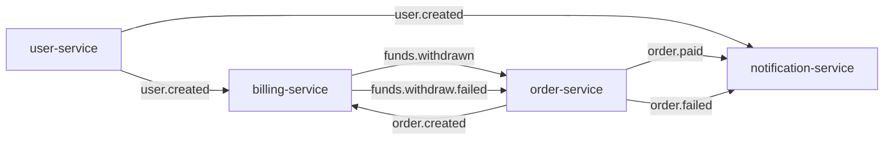

# 📦 Сервисы

Всего в проекте **7 Maven-модулей**: 4 исполняемых микросервиса и 3 общие библиотеки (`common/*`). Каждый микросервис — отдельное Spring Boot приложение со своей БД и своим `pom.xml`.

## Исполняемые сервисы

| Модуль | Порт | Назначение | БД | Kafka producer | Kafka consumer |
|---|---|---|---|---|---|
| `user-service` | 8081 | Регистрация, логин, профиль | `user_db` | `user.created` | — |
| `billing-service` | 8082 | Аккаунты, депозит, списание | `billing_db` | `funds.withdrawn`, `funds.withdraw.failed` | `user.created`, `order.created` |
| `order-service` | 8083 | Создание и статус заказов | `order_db` | `order.created`, `order.paid`, `order.failed` | `funds.withdrawn`, `funds.withdraw.failed` |
| `notification-service` | 8084 | HAPPY/ANGRY уведомления, проекция email | `notification_db` | — | `user.created`, `order.paid`, `order.failed` |

### user-service

- **Роль:** точка входа пользователя, источник `user.created`.
- **HTTP API:** `POST /auth/register`, `POST /auth/login`, `GET /api/profile`, `PUT /api/profile`, `GET /health`.
- **Схема БД:** `users (id, name, email UNIQUE, password BCrypt)` — миграция `001-create-users.yaml`.
- **Публикует:** `UserCreatedEvent(userId, email, name)` при регистрации (`UserEventPublisher.publishUserCreated`).
- **Не подписан** ни на какие топики.
- **Ключевые классы:** `AuthController`, `ProfileController`, `UserEventPublisher`, `UserRepository`, `User`.

### billing-service

- **Роль:** держатель балансов, единственный, кто «списывает» деньги.
- **HTTP API:** `GET /billing/accounts/me`, `POST /billing/accounts/me/deposit`, `GET /health`.
- **Схема БД:**
    - `accounts (id, user_id UNIQUE, balance NUMERIC(19,2))`
    - `processed_orders (order_id PK, processed_at)` — защита от повторного списания.
- **Подписан:**
    - `user.created` → создаёт аккаунт с балансом `0.00` (идемпотентно через `existsByUserId`).
    - `order.created` → проверяет баланс; при успехе списывает и публикует `funds.withdrawn`, при нехватке — `funds.withdraw.failed` с причиной `INSUFFICIENT_FUNDS` / `NO_ACCOUNT`.
- **Публикует:** `FundsWithdrawnEvent`, `FundsWithdrawFailedEvent`.
- **Ключевые классы:** `UserEventsListener`, `OrderEventsListener`, `BillingEventPublisher`, `AccountService`, `Account`, `ProcessedOrder`.

### order-service

- **Роль:** оркестратор заказа, реализует статус-машину `NEW → PAID | FAILED`.
- **HTTP API:** `POST /orders` (→ `202 Accepted`), `GET /orders/{id}`, `GET /orders`, `GET /health`.
- **Схема БД:** `orders (id, user_id, price NUMERIC(19,2), status VARCHAR(16), created_at)` + индекс `idx_orders_user_id`.
- **Публикует:**
    - `order.created` — сразу после `save(Order(status=NEW))`.
    - `order.paid` — после получения `funds.withdrawn`.
    - `order.failed` — после получения `funds.withdraw.failed`.
- **Подписан:** `funds.withdrawn`, `funds.withdraw.failed`.
- **Идемпотентность:** listener проверяет `status != NEW` и пропускает терминальные статусы.
- **Ключевые классы:** `OrderController`, `OrderService`, `OrderEventPublisher`, `BillingEventsListener`, `Order`, `OrderRepository`.

### notification-service

- **Роль:** материализует уведомления для UI и хранит проекцию email.
- **HTTP API:** `GET /notifications`, `GET /health`.
- **Схема БД:**
    - `notifications (id, user_id, order_id, type HAPPY|ANGRY, subject, body, created_at)` + индекс `idx_notifications_user_id`.
    - `user_email_projection (user_id PK, email)` — проекция email из `user.created`.
- **Подписан:**
    - `user.created` → сохраняет email в `user_email_projection`.
    - `order.paid` → `NotificationService.saveHappy(...)` — уведомление `HAPPY`.
    - `order.failed` → `NotificationService.saveAngry(...)` — уведомление `ANGRY` с причиной.
- **Не публикует** события (leaf-consumer).
- **Ключевые классы:** `NotificationController`, `NotificationService`, `UserEventsListener`, `OrderEventsListener`, `Notification`, `UserEmailProjection`.

## Общие библиотеки

### common-events

Контракты событий — обычные Java `record`. Используются всеми сервисами (producer и consumer).

```java
// Topics.java
public static final String USER_CREATED          = "user.created";
public static final String ORDER_CREATED         = "order.created";
public static final String FUNDS_WITHDRAWN       = "funds.withdrawn";
public static final String FUNDS_WITHDRAW_FAILED = "funds.withdraw.failed";
public static final String ORDER_PAID            = "order.paid";
public static final String ORDER_FAILED          = "order.failed";

// Records
public record UserCreatedEvent(Long userId, String email, String name) {}
public record OrderCreatedEvent(Long orderId, Long userId, BigDecimal price) {}
public record FundsWithdrawnEvent(Long orderId, Long userId, Long accountId,
                                  BigDecimal amount, BigDecimal balance) {}
public record FundsWithdrawFailedEvent(Long orderId, Long userId, Long accountId,
                                       BigDecimal amount, String reason) {}
public record OrderPaidEvent(Long orderId, Long userId, BigDecimal price) {}
public record OrderFailedEvent(Long orderId, Long userId, BigDecimal price, String reason) {}
```

### common-security

Stateless JWT-аутентификация для всех сервисов.

- **`JwtService`** — `generateToken(userId, email)`, `extractUserId`, `extractEmail`, `isTokenValid`. HS256, секрет из `security.jwt.secret-key`, TTL из `security.jwt.expiration-ms` (по умолчанию 1 ч).
- **`JwtAuthenticationFilter`** — `OncePerRequestFilter`, парсит `Authorization: Bearer <token>`, кладёт `AuthenticatedUser(id, email)` в `SecurityContext`.
- **`SecurityConfig`** — `permitAll` для `/health`, `/actuator/**`, `/auth/**`; `authenticated` для остального. JSON-ответы `401`/`403`. `BCryptPasswordEncoder` как `PasswordEncoder`.
- **`AuthenticatedUser`** — `record AuthenticatedUser(Long id, String email)`, инжектится в контроллеры через `@AuthenticationPrincipal`.

### common-logging

Единый формат логов и обработка ошибок.

- **`RequestLoggingFilter`** (`OncePerRequestFilter`, `HIGHEST_PRECEDENCE`) — генерирует `request_id` (UUID), кладёт в MDC `http_method`, `http_path`, `remote_ip`, `http_status`, `duration_ms`, очищает MDC в `finally`.
- **`GlobalExceptionHandler`** (`@RestControllerAdvice`) — JSON-ответы: `400` (валидация, с `details`), `500` (`database_error` / `internal_error`), `403` (`forbidden`).
- **`LifecycleLogger`** — логирует `Application started` / `Application stopping`.
- **`logback-spring.xml`** — `LogstashEncoder` с полем `service` = `spring.application.name`, `@timestamp` вместо `timestamp`.

## Взаимодействие сервисов (сводка)



## HTTP-конфигурация по умолчанию

| Параметр | Значение | Источник |
|---|---|---|
| `DB_HOST` | `localhost` (dev) / `postgres` (k8s/compose) | `shop-common` ConfigMap / `docker-compose.yml` |
| `DB_PORT` | `5432` | `shop-common` |
| `DB_USER` | `app_user` | `shop-common` |
| `DB_PASSWORD` | `securePassword123` | `shop-secrets` Secret |
| `KAFKA_BOOTSTRAP` | `localhost:9092` (dev) / `kafka:9092` (k8s/compose) | `shop-common` |
| `JWT_SECRET_KEY` | `prod-secret-key-change-it-now-32-chars-minimum` | `shop-secrets` Secret |
| `SPRING_PROFILES_ACTIVE` | `docker` | deployment.yaml / compose |

## Docker-образы

Все 4 сервиса собираются из единого `Dockerfile` с `ARG MODULE`:

```bash
./build-all.sh dev
# → shop/user-service:dev
# → shop/billing-service:dev
# → shop/order-service:dev
# → shop/notification-service:dev
```

Multi-stage: `maven:3.9-eclipse-temurin-17` для сборки, `eclipse-temurin:17-jdk-alpine` для runtime, non-root пользователь `appuser`.