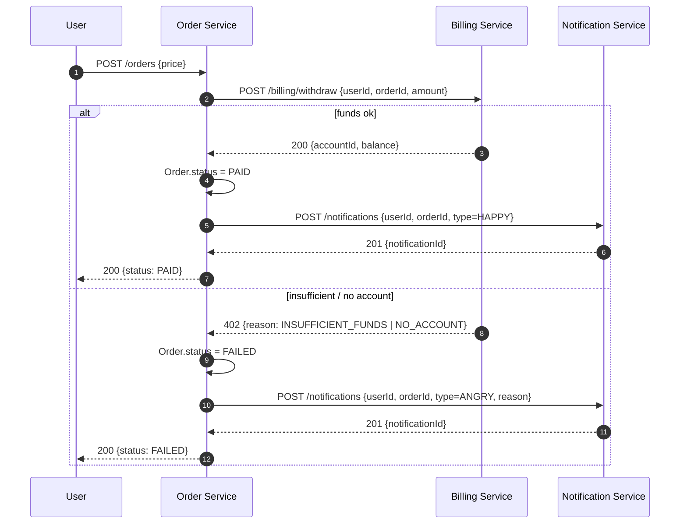
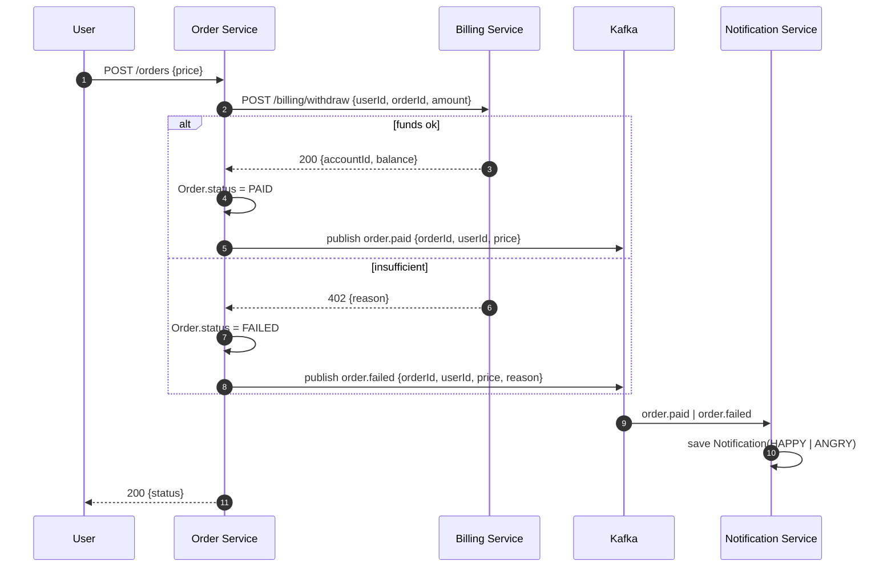
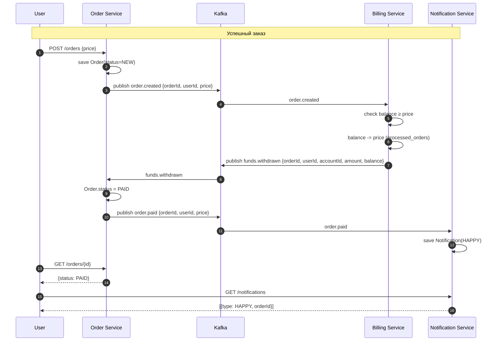
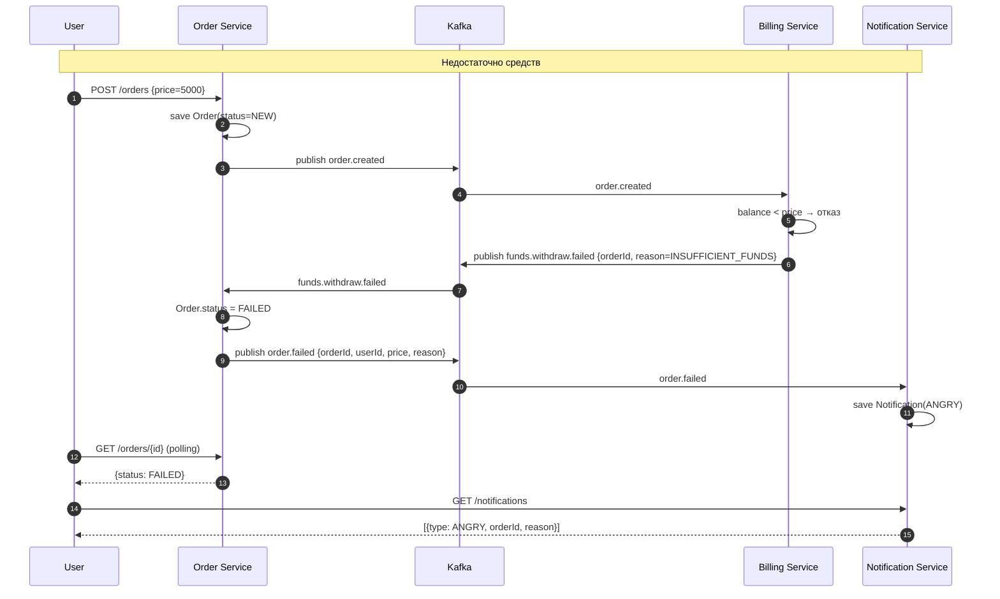
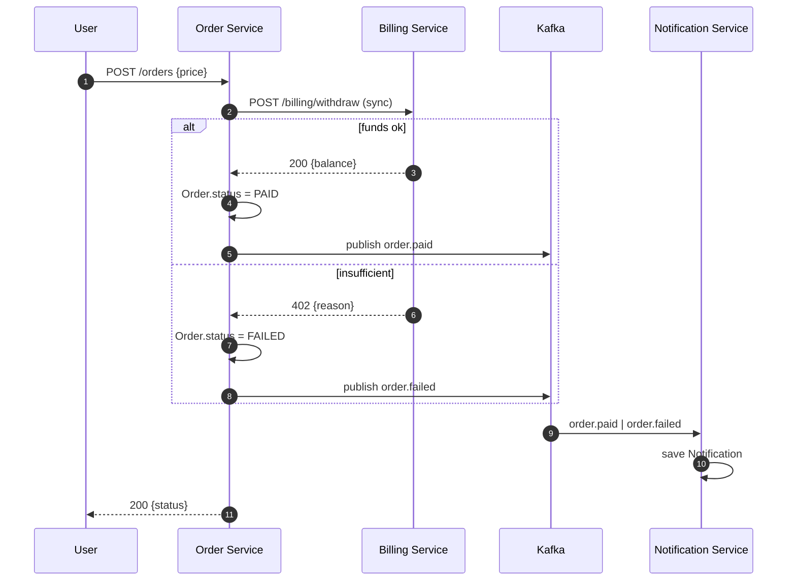

# Теоретическая часть: варианты взаимодействия сервисов

## 1. Сравнение вариантов

| Вариант | Связность | Отказоустойчивость | Сложность | Применимость |
|---|---|---|---|---|
| 1. Только HTTP | сильная | низкая (каскадные отказы) | низкая | MVP, малые системы |
| 2. HTTP + брокер для нотификаций | средняя | средняя | средняя | средние системы |
| 3. Event Collaboration | слабая | высокая | высокая | **выбран** |
| 4. Гибрид (HTTP billing + события notification) | средняя | средняя | средняя | компромисс |

**Обоснование выбора:** вариант 3 (Event Collaboration) полностью соответствует
цели ДЗ — «реализовать взаимодействие микросервисов». Он демонстрирует:

- брокер сообщений (Kafka) как единственный канал межсервисного общения;
- слабую связность: каждый сервис знает только топики, а не других участников;
- идемпотентность consumer'ов (`processed_orders`, `user_email_projection`);
- eventual consistency: заказ переходит в `PAID`/`FAILED` асинхронно после
  обработки событий в billing-service.

Сервисы могут перезапускаться, масштабироваться и развиваться независимо.
Плата — усложнение отладки и необходимость проектировать идемпотентность.

---

## 2. Вариант 1. Только HTTP-взаимодействие

Все вызовы синхронные. Order-service напрямую вызывает billing-service
(списание) и notification-service (отправка письма). Если любой из них
недоступен — заказ не создаётся.



### IDL (фрагмент, OpenAPI-style)

```yaml
# Billing Service
POST /billing/withdraw
  body:
    userId:  int64
    orderId: int64
    amount:  decimal
  responses:
    200: { accountId: int64, balance: decimal }
    402: { error: string, reason: enum[INSUFFICIENT_FUNDS, NO_ACCOUNT] }
    404: { error: string }

# Notification Service
POST /notifications
  body:
    userId:  int64
    orderId: int64
    type:    enum[HAPPY, ANGRY]
    subject: string
    body:    string
  responses:
    201: { id: int64 }

# Order Service
POST /orders
  body: { price: decimal }
  responses:
    200: { orderId: int64, status: enum[NEW, PAID, FAILED] }
```

**Плюсы:** простота, транзакционность (всё видно в одном логе), легко тестировать.
**Минусы:** сильная связность; Order-service — единая точка отказа; при падении
Notification не создаётся заказ (что семантически неверно); нет retry без
отдельной логики; нельзя масштабировать независимо.

---

## 3. Вариант 2. HTTP + брокер сообщений для нотификаций

Заказ и списание — синхронно. Отправка уведомлений — через брокер: order-service
публикует `order.paid` / `order.failed`, notification-service подписан.



### IDL

```yaml
# HTTP — как в варианте 1, но без POST /notifications

# Kafka topics
topic: order.paid
  payload: { orderId: int64, userId: int64, price: decimal }

topic: order.failed
  payload: { orderId: int64, userId: int64, price: decimal, reason: string }
```

**Плюсы:** заказ не ждёт отправки email; notification-service можно перезапускать
и масштабировать; billing остаётся синхронным — легко тестировать.
**Минусы:** billing всё ещё SPOF для создания заказа; order-service обязан
вызывать billing синхронно, что ограничивает автономность; нет событий о
факте списания — если billing упадёт после списания, но до ответа, заказ
останется `NEW` при списанных деньгах.

---

## 4. Вариант 3. Event Collaboration (выбранный)

Единственный канал межсервисного общения — Kafka. Каждый сервис публикует
доменные события о своих изменениях и подписан на события других.





### IDL — HTTP API

```yaml
POST /auth/register
  body: { name: string, email: string, password: string }
  resp 201: { id: int64, token: string }

GET  /billing/accounts/me
  resp 200: { accountId: int64, userId: int64, balance: decimal }

POST /billing/accounts/me/deposit
  body: { amount: decimal }
  resp 200: { accountId: int64, userId: int64, balance: decimal }

POST /orders
  body: { price: decimal }
  resp 202: { orderId: int64, status: enum[NEW], createdAt: datetime }

GET  /orders/{id}
  resp 200: { orderId: int64, userId: int64, price: decimal,
              status: enum[NEW, PAID, FAILED], createdAt: datetime }

GET  /notifications
  resp 200: [ { id: int64, userId: int64, orderId: int64,
                type: enum[HAPPY, ANGRY], subject: string,
                body: string, createdAt: datetime } ]
```

### IDL — Kafka-события

```yaml
topic: user.created
  producer: user-service
  consumers: [billing-service, notification-service]
  payload: { userId: int64, email: string, name: string }

topic: order.created
  producer: order-service
  consumers: [billing-service]
  payload: { orderId: int64, userId: int64, price: decimal }

topic: funds.withdrawn
  producer: billing-service
  consumers: [order-service]
  payload: { orderId: int64, userId: int64, accountId: int64,
             amount: decimal, balance: decimal }

topic: funds.withdraw.failed
  producer: billing-service
  consumers: [order-service]
  payload: { orderId: int64, userId: int64, accountId: int64?,
             amount: decimal, reason: string }

topic: order.paid
  producer: order-service
  consumers: [notification-service]
  payload: { orderId: int64, userId: int64, price: decimal }

topic: order.failed
  producer: order-service
  consumers: [notification-service]
  payload: { orderId: int64, userId: int64, price: decimal, reason: string }
```

**Плюсы:** слабая связность; сервисы автономны; отказ одного сервиса не
блокирует остальные; легко масштабировать; явная идемпотентность.
**Минусы:** eventual consistency (нужен polling или WebSocket для UI);
сложнее отладка (нужен distributed tracing); требуется проектировать
идемпотентность и DLQ.

---

## 5. Вариант 4. Гибрид (HTTP для billing + события для notification)

Списание — синхронно (проще гарантировать консистентность баланса),
уведомления — через брокер.



### IDL

Комбинация IDL из варианта 1 (`/billing/withdraw`) и варианта 2
(Kafka-топики `order.paid` / `order.failed`).

**Плюсы:** баланс консистентен сразу после ответа; отправка email не блокирует
заказ; проще, чем полный Event Collaboration.
**Минусы:** order-service обязан знать про billing (сильная связность по
одному плечу); если billing упадёт после списания, но до ответа — заказ
останется `NEW` при списанных деньгах (та же проблема, что в варианте 2);
billing остаётся SPOF.

---

## 6. Итоговая таблица выбора

| Критерий | В1 HTTP | В2 HTTP+Kafka | В3 Event Collab | В4 Гибрид |
|---|---|---|---|---|
| Слабая связность | ✗ | ~ | ✓ | ~ |
| Отказоустойчивость | ✗ | ~ | ✓ | ~ |
| Простота отладки | ✓ | ~ | ✗ | ~ |
| Консистентность баланса | ✓ | ~ | ~ | ✓ |
| Масштабируемость | ✗ | ~ | ✓ | ~ |
| Соответствие цели ДЗ | ✗ | ~ | **✓** | ~ |

**Выбран вариант 3 (Event Collaboration)** — как наиболее полно отвечающий
цели задания «реализовать взаимодействие микросервисов для обработки заказов».
Реализация — в основном коде проекта (см. `common-events`, `kafka/` в каждом
сервисе, `ARCHITECTURE.md`).